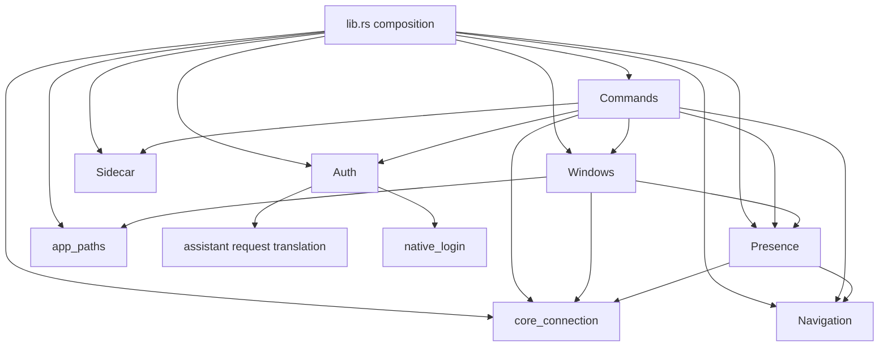
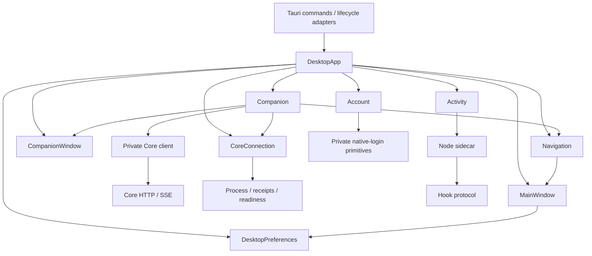

# Desktop architecture

Status: D-0 decided by Mohammed on 2026-10-25. Tasks enter
[`../stages.md`](../stages.md) one at a time as `N-<n>`, each naming its `D-<n>`.
The analysis that follows was written read-only by Codex from `fix/flaky-tests`
at `24a64289`.

## Decision (D-0)

- **One crate, module boundaries first.** The Tauri crate stays one crate; no
  module becomes a crate until a second consumer or a compiler-held boundary
  needs it.
- **One top object, `DesktopApp`** (`src-tauri/src/app.rs`), built once, the
  only value in Tauri managed state. It owns the nine owners of section 6:
  `CoreConnection`, `Companion`, `CompanionWindow`, `MainWindow`, `Navigation`,
  `DesktopPreferences`, `Account`, `Activity`, `AppPaths`. Fields are private;
  each owner receives only its declared dependencies.
- **Dependencies point one way,** as drawn in section 6. Commands translate
  only; multi-owner workflows are methods on the owner (`Companion` for
  companion workflows). `AppHandle` is for window and event work, never a
  service lookup.
- **Window code holds no conversation state:** `CompanionWindow` owns its
  surface DTO and receives what it shows.
- **One private Core client inside `Companion`** for binding, observation and
  submission; `CoreConnection` keeps its own readiness handshake.
- **Behaviour and stored identity do not change:** captured retries, newer
  binding precedence, watcher replacement, publication acknowledgement,
  foreground restoration, `app.nylra.desktop`, DPAPI and sidecar storage.

Not decided, and not needed for this restructure: distribution, activity
retention, physical native acceptance, retained assistant APIs (section 8,
items 2 to 7).

---


AYLUL already has useful ownership boundaries, separate processes, source contracts, and substantial behavior tests. Its main architectural weakness is **coordination outside those owners**: commands, `lib.rs`, and native window code reach across several modules or resolve dependencies through Tauri managed state.

**Recommendation:** establish private service boundaries inside the existing Tauri crate, introduce one `DesktopApp` composition root, and enforce the boundaries with a shrinking architecture ratchet. The evidence does not justify extracting a crate per desktop module now.

This was read-only analysis on `fix/flaky-tests`. No files were changed, no builds or tests were run, and no branch was switched. No language-server tool was exposed, so inspection used plain file reads. The concurrent `crates/` changes were excluded from findings.

## 1. Inventory

Counts are physical lines, including comments, blank lines, inline tests, and separately named test files. Source counts exclude contracts, manifests, lockfiles, generated ACL schemas, and binary assets unless explicitly stated.

### Rust native application

Prefix: `apps/desktop/src-tauri/src/`.

**52 Rust files, 9,190 lines.** Eleven files, totaling 2,899 lines, are dedicated tests or fixtures; other files also contain inline tests.

| Module | Files / lines | Implemented job and constituent files | Coverage |
|---|---:|---|---|
| `main.rs` | 1 / 4 | Enter the native application | No explicit code-map row |
| `lib.rs` | 1 / 164 | Assemble native lifetime; currently also coordinates companion publication | Code map; no composition contract |
| `app_paths.rs` | 1 / 58 | Resolve native storage locations | Code map; no colocated contract |
| `navigation.rs` | 1 / 69 | Retain the latest unacknowledged main destination | Code map; shared-request reference |
| `assistant/` | 1 / 147 | Translate retained account-assistant requests into closed backend operations | Contract and map |
| `auth/` | 7 / 995 | Coordinate protected account access | Contract and map |
| `commands/` | 4 / 465 | Expose window-restricted native operations | Contract and map |
| `core_connection/` | 4 / 791 | Verify or start the configured local Core runtime | Contract and map |
| `native_login/` | 5 / 455 | Implement Windows login primitives | Contract and map |
| `presence/` | 16 / 4,351 | Operate the selected conversation’s companion | Contract and map; several explicit test rows |
| `sidecar/` | 1 / 231 | Own the Node child’s stdio lifetime | Contract and map |
| `windows/`, excluding companion | 5 / 576 | Control the main native surface | Contract and map |
| `windows/companion/` | 5 / 884 | Control the independent companion surface | Separate contract and map |

The constituent file-backed modules are:

| Area | Files and their jobs, with line counts |
|---|---|
| `auth/` | `mod.rs` 77: serialize account actions; `service.rs` 293: account workflows; `http.rs` 117: bounded backend HTTP; `store.rs` 46: credential persistence; `wire.rs` 129: wire validation; `acceptance.rs` 168: opt-in integration acceptance; `policy_tests.rs` 165: account policy regressions |
| `commands/` | `mod.rs` 52: account/activity IPC; `desktop.rs` 191: connection/binding/navigation IPC; `companion.rs` 182: companion IPC; `preferences.rs` 40: preference IPC |
| `core_connection/` | `mod.rs` 191: revisioned connection lifecycle; `config.rs` 96: launch configuration plus JSON persistence primitives; `launch.rs` 221: process attachment/start verification; `connection_tests.rs` 283: lifecycle regressions |
| `native_login/` | `mod.rs` 9: exports; `browser.rs` 50: reviewed browser launch; `loopback.rs` 217: callback capture; `protected_store.rs` 158: DPAPI persistence; `random.rs` 21: OS randomness |
| `presence/` | `mod.rs` 254: binding lifecycle; `binding.rs` 121: binding validation HTTP; `client.rs` 300: observer HTTP/SSE; `preferences.rs` 57: binding persistence; `preview.rs` 86: plain-text preview extraction; `projection.rs` 311: presentation state machine; `send.rs` 388: captured submission admission; `watcher.rs` 304: observer replacement; `watcher/feed.rs` 395: one conversation’s reconciliation loop |
| Presence tests | `appearance_tests.rs` 339; `binding_tests.rs` 262; `send_tests.rs` 313; `tests.rs` 375; `watcher_tests.rs` 415 |
| Presence fixtures | `send_fixture.rs` 212; `watcher_fixture.rs` 219 |
| `windows/` | `mod.rs` 103: main/tray actions; `main_policy.rs` 85: privileged main document policy; `placement.rs` 75: main-window recovery geometry; `preferences.rs` 165: saved close policy and OS login-item coordination; `preferences_tests.rs` 148: preference regressions |
| `windows/companion/` | `mod.rs` 268: surface lifecycle; `input.rs` 182: editor focus/bounds; `state.rs` 261: revisioned surface model; `placement.rs` 72: complete-rectangle fitting; `no_activate.rs` 101: foreground-safe Win32 operations |

Additional native support:

- Two acceptance examples: `examples/auth_state.rs`, 19 lines; `examples/native_fixture.rs`, 56 lines.
- `build.rs`: 32 lines.
- `Cargo.toml`: 41 lines.
- Two window capabilities.
- One handwritten permission file containing two permission groups.
- Twenty-five autogenerated command permission files.
- Generated ACL/schema JSON under `src-tauri/gen/schemas/`.

There are **nine native colocated contracts**. The code map covers owners mostly by directory; it does not provide Core-style exhaustive per-file ownership enforcement.

### TypeScript UI

The desktop’s main window comes from **`web/`**, not `apps/desktop/src/`. The latter now contains the independent companion, retained browser presence, and development studio.

Prefix: `apps/desktop/src/`.

| Area | Files / lines | One job | Coverage |
|---|---:|---|---|
| `app/companion.tsx` | 1 / 4 | Mount the native companion | Contract and map |
| `platform/` | 2 / 73 | Validate companion IPC projections | Contract and map |
| Companion root files | 13 / 839 | Present companion interactions | Parent contract and map |
| `features/companion/animation/` | 4 / 339 | Advance instance-local presentation | Parent contract |
| `features/companion/renderer/` | 8 / 1,814 | Draw explicit frame inputs | Parent contract |
| `features/companion/studio/` | 7 / 716 | Review synthetic character scenes | Separate contract and map |
| `studio.tsx` | 1 / 5 | Mount development studio | Map and studio contract |
| `vite-env.d.ts` | 1 / 1 | Declare Vite environment types | No separate contract |
| `api/generated/nylra-v1.d.ts` | 1 / 3,445 | Retain backend-generated declarations | Provenance record; external schema owner |

**Total: 38 files, 7,236 lines**, of which 3,445 lines are generated declarations. Handwritten source is **3,791 lines**.

Important entry files and internal jobs:

- `DesktopCompanion.tsx`: native companion composition.
- `CompanionComposer.tsx`: scoped editor interaction.
- `composer-model.ts`: draft/retry identity.
- `native-presentation.ts`: native preview lifetime.
- `desktop-gesture.ts`: click/drag discrimination.
- `CompanionCanvas.tsx`: Canvas resource lifecycle.
- `Companion.tsx`: retained controlled browser presence.
- `SpeechBubble.tsx`: accessible supplied text.
- `types.ts`, `catalog.ts`: character presentation vocabulary.
- Animation: `model.ts`, `scheduler.ts`, `geometry.ts`, `messages.ts`.
- Renderer: `scene.ts`, `character.ts`, `eyes.ts`, `hands.ts`, `crystals.ts`, `outfits.ts`, `effects.ts`, `palette.ts`.

The current handwritten desktop UI has no import of the retained `api/generated/nylra-v1.d.ts`.

### Sidecar

Prefix: `apps/desktop/sidecar/src/`.

**25 TypeScript files, 1,693 lines**, including eleven colocated test files totaling 862 lines.

| Area | Files / lines | One job | Coverage |
|---|---:|---|---|
| Root | 6 / 333 | Compose desktop activity access | Contract and map |
| `hooks/` | 6 / 319 | Receive external hook events | Contract and map |
| `sessions/` | 3 / 174 | Project hook events into activity | Contract and map |
| `approvals/` | 2 / 276 | Hold person-answerable requests | Contract and map |
| `agents/` | 6 / 423 | Edit Claude Code integration settings | Contract and map |
| `store/` | 2 / 168 | Persist local activity records | Contract and map |

Production modules:

- Root: `main.ts` 43; `handlers.ts` 80; `rpc.ts` 31; `protocol.ts` 26.
- Hooks: `endpoint.ts` 23; `server.ts` 61; `route.ts` 31.
- Sessions: `session.ts` 57; `steps.ts` 39.
- Approvals: `approvals.ts` 126.
- Agents: `install.ts` 51; `rules.ts` 53; `settings-file.ts` 103.
- Store: `store.ts` 107.

### Hook, scripts, tests

| Area | Files / lines | Job |
|---|---:|---|
| `apps/desktop/hook/src/` | 2 / 353 | Carry one Claude Code hook invocation |
| `hook/src/main.rs` | 1 / 44 | Read process input/environment; print the permitted answer |
| `hook/src/lib.rs` | 1 / 309 | Bound pipe exchange and failure behavior |
| `apps/desktop/scripts/` | 3 / 45 | Assemble desktop assets or synchronize generated declarations |
| `apps/desktop/tests/` root | 12 / 925 | Assembly/ACL checks and native acceptance drivers |
| `apps/desktop/tests/companion/` | 21 / 1,560 | Companion unit/browser/production checks plus fixtures |

The hook has its own workspace and contract.

Across the requested source trees there are **20 colocated contracts**: nine native, four UI, six sidecar, one hook.

## 2. Dependencies, cycles, commands, Core integration

### Native owner graph

The production cross-owner dependencies are acyclic:



The problematic edge is **`windows → presence`**: editor refresh reaches the conversation owner through Tauri’s state registry. The companion window also imports presence-owned presentation types.

### Internal dependency paths

- `core_connection/mod.rs → config.rs, launch.rs`; launch consumes the parent’s `ReadyConnection`.
- `auth/mod.rs → service.rs`; service uses `http`, `store`, `wire`, `native_login`, and retained assistant translation.
- `auth/http.rs → wire.rs`; `auth/store.rs → wire.rs, native_login`.
- `native_login/loopback.rs` and `protected_store.rs → random.rs`.
- `presence/mod.rs → binding, preferences, send`.
- `presence/send.rs → parent Presence state, binding`.
- `presence/watcher.rs → watcher/feed.rs`.
- Feed → watcher’s channels/types, `client`, `projection`, binding types.
- `client.rs → binding` DTOs and projection DTOs.
- `projection.rs → preview.rs`.
- `presence/preferences.rs → core_connection/config.rs` JSON helpers.
- `windows/mod.rs → preferences, placement, main_policy, companion`.
- `windows/companion/mod.rs → input, placement, no_activate, state`.
- Companion construction also uses `windows/main_policy.rs`’s HTML-fallback policy.

At production file level, these local implementation pairs form cycles:

1. `core_connection/mod.rs ↔ launch.rs`
2. `presence/mod.rs ↔ send.rs`
3. `presence/watcher.rs ↔ watcher/feed.rs`
4. `windows/companion/mod.rs ↔ input.rs`

These arise from child implementations using parent-owned types or state. They are **not cross-service cycles** and do not independently justify extraction. Test `super::*` imports and module declarations are excluded from this cycle classification.

### Cross-owner internal access

These accesses are legal under current Rust visibility. They are architectural exposure, not claims of Rust privacy being bypassed.

| Caller | Access | Consequence |
|---|---|---|
| [`lib.rs`](../../../../apps/desktop/src-tauri/src/lib.rs:63) | Constructs nine independently managed state values | No single native object is the ownership map |
| `lib.rs` publication callback | Reads `Presence.connection`, binding generations, runtime identity | Publication admission partly lives in composition |
| `lib.rs` | Calls `windows::companion::input::refresh` | Composition reaches an implementation submodule |
| `commands/desktop.rs` | Coordinates Presence, Watcher, and companion visibility tokens | Adapter owns multi-owner workflows |
| `commands/companion.rs` | Resolves Presence and Navigation through `AppHandle.state` | Dependencies are discovered at runtime |
| `commands/preferences.rs` | Consumes `windows::preferences::Store`; constructs `PluginLoginItem` | Adapter knows persistence/platform implementation |
| `commands/mod.rs` | Returns `auth::service::View` | Public IPC type is exposed through an implementation module |
| Commands | Name `presence::send` types and companion `state` types | No narrow owner entry surface |
| `windows/main_policy.rs` | Resolves Connection and AppPaths from managed state | Window construction discovers dependencies |
| `windows/companion/input.rs` | Resolves Presence and calls `context()`/`view()` | Window implementation knows conversation ownership |
| Companion window/state | Uses `presence::projection::PresenceProjection` | Surface DTO couples the window owner to the producer |
| `presence/preferences.rs` | Uses `core_connection::config::{read_json, write_json}` | Connection configuration accidentally owns shared persistence infrastructure |

Within the sidecar:

- `handlers.ts` directly uses Store, Approvals, settings planning, installation, and an adapter-local preview map.
- `hooks/route.ts` directly coordinates sessions, Store, Approvals, and grant-use detection.
- `main.ts` imports `settingsFor` from `handlers.ts`, so composition depends on an adapter helper.
- Store imports domain types from sessions and approvals; it owns all their SQL through one private `#db`.

The database handle is private, but domain persistence APIs are shared rather than private to each domain.

### Every registered Tauri command

All 27 handlers are registered in `src-tauri/src/lib.rs`.

| Adapter file | Commands | Current behavior owner |
|---|---|---|
| `commands/mod.rs` | `hide_main` | Direct window action |
| Same | `auth_action`, `cancel_login` | AuthController |
| Same | `aylul_call` | Native Sidecar |
| `commands/preferences.rs` | `desktop_preferences`, `set_desktop_preferences` | Windows preference Store |
| `commands/desktop.rs` | `desktop_connection`, `desktop_connection_config`, `save_desktop_connection`, `retry_desktop_connection` | Connection |
| Same | `open_external` | OS browser logic inside the command |
| Same | `companion_binding`, `set_companion_previews` | Presence |
| Same | `select_companion_agent` | Command coordinates Presence and companion visibility |
| Same | `target_companion_thread` | Command coordinates Presence and Watcher |
| Same | `refresh_companion_appearance` | PresenceWatcher |
| Same | `navigation_snapshot`, `ack_navigation` | Navigation |
| `commands/companion.rs` | `companion_state`, `companion_input`, `companion_ready`, `companion_failed`, `set_companion_visible`, `set_companion_paused`, `drag_companion` | Companion window |
| Same | `companion_send` | Presence submission |
| Same | `open_main_from_companion` | Command coordinates Presence, Navigation, main window |

**Concrete drift:** [`build.rs`](../../../../apps/desktop/src-tauri/build.rs:1) declares 25 commands. It omits `companion_send` and `companion_input`; those names appear in registration and the handwritten companion permission group. The generated ACL contains no individual `allow-companion-send` or `allow-companion-input` entries.

This demonstrates incomplete command-list parity. It does not, by itself, prove that the custom group fails to grant those commands.

### TypeScript and sidecar graphs

No production TypeScript import cycle was found, including type-only imports.

The companion’s main path is:

```text
app/companion.tsx
  → DesktopCompanion
      → platform/companion
      → CompanionComposer → composer-model
      → native-presentation → animation/messages
      → desktop-gesture
      → CompanionCanvas
          → animation/model, scheduler, geometry
          → renderer/scene → character → drawing parts
```

Studio imports the reusable renderer/model directly. Production companion imports do not reach studio.

Sidecar:

```text
main → handlers → approvals → sessions/steps → protocol
  │        │          └→ agents/rules
  │        ├→ agents/install → settings-file → rules
  │        └→ store
  └→ hooks/server, endpoint, route
                         ├→ sessions
                         ├→ approvals
                         ├→ store
                         └→ rules
```

### How desktop reaches Core

There are distinct paths with different jobs:

| Path | Transport | Owner |
|---|---|---|
| Packaged main dashboard | HTTP through `web/src/api/`; SSE through `web/src/stream/` | Shared web client |
| Runtime startup/attachment | Process launch, receipt files, OS process identity, `/api/runtime` | `core_connection/` |
| Binding/navigation validation | Blocking HTTP reads | `presence/binding.rs` through `presence/core_client/` |
| Companion observation | Async HTTP snapshots plus SSE | watcher through `presence/core_client/` |
| Companion submission | Blocking HTTP create/session/model/turn calls | `presence/send.rs` through `presence/core_client/` |

Binding, observation and submission share **one private client** (`presence/core_client/`): blocking requests for binding and submission, async snapshots and SSE for observation. The architecture ratchet refuses `reqwest` anywhere else in the companion.

The sidecar is separate:

```text
Claude Code
 → aylul-hook.exe
 → Windows named pipe
 → Node sidecar
 → aylul.db
 → stdio RPC
 → Tauri
 → shared main activity UI
```

It does not use Core HTTP/SSE or read Core’s SQLite database. Native launch code checks the configured database’s canonical identity; it does not query its contents.

## 3. State ownership and duplicated rules

### Shared and persisted state

[`lib.rs`](../../../../apps/desktop/src-tauri/src/lib.rs:63) registers **nine managed values**:

| State | Writer/owner | Lifetime or persistence |
|---|---|---|
| Desktop preference Store | `windows/preferences.rs` | `desktop-preferences-v1.json`; OS login item |
| AuthController | `auth/mod.rs` | Busy/cancellation atomics |
| Companion Store | `windows/companion/` | Visibility, pause, readiness, placement, composer view, presentation |
| PresenceWatcher | `presence/watcher.rs` | Observer epoch, channels, readiness |
| Presence | `presence/mod.rs`, `send.rs` | Binding, action tickets, draft scope, captured retry |
| Navigation | `navigation.rs` | Latest pending destination/revision |
| Connection | `core_connection/mod.rs` | Configuration, startup epoch, verified runtime |
| AppPaths | `app_paths.rs` | Immutable storage/acceptance locations |
| SidecarState | `sidecar/mod.rs` | Child, stdin, request IDs, waiting responses |

No production Rust `static` state declaration was found in the native source.

Disk and OS ownership:

| Resource | Writer |
|---|---|
| `desktop-core.json` | Connection |
| `runtimes/<configuration>.pending.json` | Native launch owner |
| Runtime receipt JSON | Core process; native consumes it |
| Startup lock file | Native launch owner |
| `desktop-presence.json` | Presence preferences |
| `desktop-preferences-v1.json` | Desktop preference Store |
| `auth-v1.dpapi` | Auth Store through native DPAPI primitives |
| `%LOCALAPPDATA%\AYLUL\aylul.db` | Sidecar Store |
| `%LOCALAPPDATA%\AYLUL\hook.json` | Sidecar endpoint owner |
| Claude global `settings.json` hook entries | Sidecar installer through settings writer |
| Project `.claude/settings.local.json` rules | Sidecar approval workflow through settings writer |
| Sidecar backup files | Settings writer |
| Core provider keys/profile homes | Core ownership; desktop passes references or uses APIs |

Desktop account storage uses **DPAPI**, not a desktop keyring dependency. Core’s master-key storage belongs to Core’s separate ownership.

Other live state:

- Sidecar Approvals owns pending requests, held reply callbacks, and timers.
- `handlers.ts` independently owns rule-preview admission state.
- The hook owns only one process invocation.
- React owns drafts, attempts, gesture state, Canvas instances, and message timers.
- `renderer/palette.ts` has a module-level WeakMap cache of immutable palettes.
- Shared main also keeps native connection/targeting projections and an in-memory companion-send problem store.

Two assumptions need explicit enforcement:

1. Endpoint publication/removal unconditionally writes/deletes `hook.json`. There is no endpoint-instance check preventing an older overlapping sidecar from deleting a replacement’s file.
2. The native debug acceptance path disables the sidecar. That fixture cannot establish joint Core/sidecar lifetime behavior.

### Rules repeated across paths

| Rule | Repeated locations | Assessment |
|---|---|---|
| Agent/thread eligibility | `binding.rs`, `client.rs`; preliminary filtering in `web/src/desktop/companion-send.ts` | Native duplication should share semantic validation. Web filtering remains presentation; native/Core remain authoritative |
| Runtime identity comparison | Launch verification, binding reads, observer validation, retry admission, publication callback | Checks serve different moments; consolidate each invariant’s implementation without removing checkpoints |
| First-send sequence | Native `send.rs`; web conversation draft/composer | Explicitly permitted by desktop spec §8A; preserve with request-order/body parity checks |
| Submission/retry identity | TS composer model, native captured request, Core idempotency | Different responsibilities: retain draft identity, capture exact request, enforce durable replay |
| Operation terminality | Native projection; web conversation state; Core operation status | Native/web project Core facts. They should not invent independent business transitions |
| Preview limits/lifetime | Rust preview/projection; TS validators and native presentation | Defensive validation is appropriate; repeated policy constants need agreement coverage |
| Render permission | Native surface model; TS state acceptance; Canvas scheduling | Intentional authority chain: native grants, TS obeys |
| Command caller restrictions | Handwritten ACL, native guards, `allowed_caller`, registration, build metadata | Defense is useful; independently maintained lists already drift |
| Narrow-rule admission | Handler, Approvals, settings writer | Calls reuse `isNarrowRule`; this is repeated enforcement of one predicate |
| Rule preview identity | Main UI preview guard; sidecar preview map/fingerprint | Both boundaries need checks; sidecar owns authorization |
| Loopback origin shape | Native LaunchConfig; shared web daemon-origin validation | Maintain explicit accepted/rejected parity cases |

Do not “deduplicate” these by allowing the renderer to authorize actions, removing native checks because TS checked first, or moving Core rules into desktop.

## 4. Mixed jobs, large files, misplaced tests

### Files whose responsibilities should separate

| File | Distinct jobs currently present |
|---|---|
| `src-tauri/src/lib.rs` | Construct owners; admit watcher publications; synchronize binding; refresh editor context; emit UI events |
| `commands/desktop.rs` | Translate IPC; coordinate selection/show; coordinate retarget/readiness; launch external links |
| `commands/companion.rs` | Guard callers; translate IPC; resolve destination; persist navigation; restore main |
| `core_connection/config.rs` | Validate launch configuration; implement generic JSON persistence |
| `presence/binding.rs` | Define binding DTOs; perform HTTP reads; validate eligibility |
| `presence/client.rs` | Transport bounded HTTP/SSE; validate agent/provider/thread relationships; choose user-facing failure statuses |
| `sidecar/src/handlers.ts` | Translate RPC; retain approval preview authority; locate project settings |
| `sidecar/src/hooks/route.ts` | Translate hook events; coordinate persistence; infer recorded grant usage |

Two larger owner scopes also need care:

- `windows/` contains main surface policy, preference persistence, and OS autostart coordination.
- Sidecar `agents/` contains narrow-rule policy, hook installation policy, and filesystem replacement infrastructure.

These need explicit internal owners. Their current size does not justify services or packages for every file.

### Size findings

- Largest handwritten desktop source: `renderer/character.ts`, **816 lines**.
- Next substantial drawing file: `renderer/outfits.ts`, **303 lines**.
- Largest production Rust files: `watcher/feed.rs`, **395 lines**; `send.rs`, **388 lines**.
- Largest native file overall: `watcher_tests.rs`, **415 lines**.
- Generated declarations: **3,445 lines**; not a refactoring target.

`character.ts` composes ordered drawing passes. Its size alone is not a defect. Splitting it mechanically risks changing the artwork or draw order without improving ownership.

There are no literal `helpers.rs` or `utils.rs` grab bags in the inspected native source. `core_connection/config.rs` is the clearest accidental utility provider.

### Test placement

Native and sidecar tests mostly live with their owners.

Exceptions or improvement points:

- `presence/tests.rs` tests both projection behavior and preview sanitization. Move preview-specific cases with `preview.rs`; preserve feed integration tests.
- Companion pure unit tests live centrally under `tests/companion/`, despite testing separate animation, gesture, palette, composer, and platform owners.
- `tests/native-acl.test.mjs` is appropriately cross-owner.
- Native acceptance drivers appropriately remain outside production modules.
- Browser and production-bundle tests should remain integration tests rather than being forced into renderer folders.

### Documentation drift

The inspected map and contracts are useful but not fully current as architecture guidance:

- `apps/desktop/AGENTS.md` still describes normal chat through Hermes clients, while README and the newer desktop spec describe the shared Core dashboard.
- Brain and character spec headings retain initial “not implemented”/planning statuses despite later implemented slices.
- Hook design still names the retired desktop sessions/approvals screen paths.
- The native owner instructions call sidecar “the cloud link”; current sidecar source is local hook/activity integration.
- The code map calls `lib.rs` composition-only, while it contains publication admission logic.

These should be amended in their existing owners, not replaced by another competing source map.

## 5. What holds boundaries today

| Mechanism | What it holds | Limit |
|---|---|---|
| Separate Cargo workspaces/processes | Desktop, hook, Core compilation/lifetime separation | Does not partition native modules |
| Private fields and modules | Auth database material, sidecar database handle, most state mutation | Broad public nested APIs and managed-state lookup remain |
| Separate capabilities | Main versus companion command authority | Command inventories are not fully cross-checked |
| Native label/current-window guards | Caller surface restrictions | Several different guard implementations |
| CSP/navigation restrictions | Privileged surfaces stay local; main connects to configured Core origin | Requires native acceptance beyond source inspection |
| Sidecar method allowlist | Limits stdio methods | No complete parity check against handlers/wrappers |
| Hook token/deadlines | Rejects unauthenticated pipe requests; bounds hook waiting | Default pipe ACL and endpoint-file assumptions remain |
| Native behavior tests | Binding races, captured retry, replay, stale publications, rendering permission | Passing results were not established in this analysis |
| Companion contract test | Checks named exports/test references for two contracts | Does not cover all desktop contracts or semantic ownership |
| Production bundle test | Excludes studio, fixtures, account/activity code from companion | Not invoked by AYLUL workflow |
| Desktop assembly tests | Shared-main/companion asset separation | Does not validate all source imports |
| Shared web checks | Web code map, API generation, native projection parity | Separate from companion-source enforcement |

The [AYLUL workflow](../../../../.github/workflows/aylul.yml) configures:

- Native and hook formatting, clippy, tests.
- Desktop frontend build.
- Top-level desktop Node tests.
- Sidecar typecheck/tests.
- Real hook executable roundtrip support.

However, `npm test` selects `tests/*.test.*`. It does **not** invoke:

- `test:companion:unit`
- `test:companion:browser`
- `test:companion:production`
- The opt-in native bootstrap journey

The separate root web workflow runs shared-main web checks; it does not close this companion gap.

There is currently no inspected desktop equivalent of Core’s ratchet holding:

- Single composition root.
- Constructor location.
- Allowed owner dependencies.
- Absence of service-locator access.
- Private domain stores.
- Contract/code-map completeness.
- Complete IPC inventory parity.
- Sidecar SQL ownership.
- Prohibition of new direct fetch/IPC/database paths.

Clippy is configured as a warning gate, not an architecture checker.

## 6. Target structure and enforcing checks

### Keep module boundaries first

Keep one Tauri crate and the existing hook executable. Strengthen the sidecar in place.

Reasons:

- Native production source is modest once dedicated fixtures are excluded.
- The cross-owner graph is already acyclic.
- Much of native code is tightly coupled to one Tauri application/UI thread.
- Immediate extraction would harden today’s exposed DTOs and coordination mistakes.

Crate extraction should follow a demonstrated reusable consumer or a boundary that needs compiler-level separation. No such additional consumer was established here.

### One native top object

Introduce `src-tauri/src/app.rs` with **`DesktopApp`**:

- Construct once.
- Own assembly and shutdown.
- Register one managed `Arc<DesktopApp>`.
- Expose typed owner accessors.
- Keep fields private.
- Inject only declared dependencies into services.
- Prohibit service code from resolving arbitrary managed state.

`AppHandle` remains legitimate for native window/event operations. It must not act as a service registry.

Suggested owners:

| Owner | One job |
|---|---|
| `CoreConnection` | Establish a verified local runtime connection |
| `Companion` | Operate the bound conversation companion |
| `CompanionWindow` | Control the native companion surface |
| `MainWindow` | Control the native main surface |
| `Navigation` | Deliver the latest closed main destination |
| `DesktopPreferences` | Coordinate machine-specific desktop preferences |
| `Account` | Coordinate protected account access |
| `Activity` | Expose the owned hook sidecar |
| `AppPaths` | Supply immutable native locations |

`Companion` absorbs existing binding, watcher, submission, and explicit companion workflows. Its private modules retain their focused jobs.

Its private Core client becomes the single native **business API** implementation for binding reads, observation, and submission. `CoreConnection` retains its distinct readiness handshake. The shared web client remains independently owned.

The native window owns its public surface DTO. Conversation projection maps into that DTO; window code does not import the conversation producer or resolve it from Tauri state.

### Allowed dependency directions



Tray callbacks are wired with explicit actions. They do not discover Companion or other owners through a registry.

### Sidecar target

Retain one composition function/object, such as `createActivityApp`, with:

- `Sessions`: session projections and steps.
- `Approvals`: pending lifecycle plus preview/approval admission.
- `AgentSettings`: hook installation and permission-rule edits.
- `HookEndpoint`: authenticated pipe lifetime.
- Private persistence APIs belonging to their domain.

A single SQLite connection may remain. Domain stores receive it during composition; adapters receive service operations, not the shared Store.

Move `rulePreviews` into the approval owner. Move `settingsFor` into settings ownership. Keep process shutdown and endpoint lifetime in composition.

### TS modules and entries

Keep existing paths where useful; add public entry files only where there are actual cross-owner consumers:

| Module | Entry |
|---|---|
| Native companion startup | `src/app/companion.tsx` |
| Native companion IPC | `src/platform/companion.ts` |
| Native companion feature | `features/companion/DesktopCompanion.tsx` |
| Reusable character drawing | `features/companion/renderer/index.ts` |
| Motion model | `features/companion/animation/index.ts` |
| Development studio | `features/companion/studio/CompanionStudio.tsx` |

Rules:

- Only platform code imports Tauri APIs in this source tree.
- Renderer/animation import no platform or studio code.
- Production feature imports no studio or test fixture.
- Companion renderer performs no HTTP.
- Studio uses renderer/model public entries.
- Main screens stay in `web/`.
- Avoid one feature barrel exporting every internal module.

### Ratchet design

Add parser-backed checks early, with separate baselines per owner:

1. Resolve Rust imports, qualified paths, reexports, constructors, and managed-state lookup.
2. Enforce allowed owner edges and reject new cycles.
3. Reject cross-owner store/state access.
4. Require service construction in `DesktopApp` or sidecar composition.
5. Restrict native Core HTTP, TS raw IPC, SSE, and SQLite to declared owners.
6. Check contract/map coverage.
7. Compare command handlers, build metadata, permission groups, guards, and wrapper inventories.
8. Compare sidecar methods with native allowlist and main wrappers.
9. Check TypeScript static/dynamic import boundaries.
10. Detect SQL ownership violations even with a shared connection.

Allowlist rules:

- Exact, reviewable violations.
- New violations fail.
- Stale exemptions fail.
- Removal deletes the exemption.
- Pure moves permit one-to-one relocation only.
- Adversarial fixtures prove the checker catches bypasses.

Do not replace behavior tests with these checks. Static analysis cannot establish Windows focus, tray behavior, settings race safety, or provider acceptance.

## 7. Ordered task list

These are **proposed task packets**, not authorized implementation. Every source task includes its affected contract and code-map updates.

### D-0 · Decide the desktop architecture

- **Touch:** desktop owner spec; `apps/desktop/AGENTS.md`; `docs/aylul/codebase/README.md`; relevant native/UI stages.
- **Needs:** Mohammed’s architecture ruling.
- **Done-when:** owners, state, public interfaces, dependency directions, retained behavior, and exceptions are explicit; stale guidance is reconciled.

### D-1 · Establish the shrinking architecture ratchet

- **Touch:** `src-tauri/tests/architecture/`; integration-test entry; native dev dependencies if needed; `tests/architecture/`; desktop test scripts; `.github/workflows/aylul.yml`; baseline files.
- **Needs:** D-0.
- **Done-when:** current violations are enumerated; new/stale violations fail; mutation fixtures cover imports, constructors, state lookup, SQL, and IPC inventory; checks run in CI.

### D-2 · Close command inventory drift

- **Touch:** `src-tauri/build.rs`; command registration/guards; permission sources; generated permissions through their generator; `tests/native-acl.test.mjs`; command contract.
- **Needs:** D-1.
- **Done-when:** all 27 commands have matching declared metadata and surface policy; both missing commands are covered; an omitted command makes parity checks fail.

### D-3 · Introduce the single native composition root

- **Touch:** new `src-tauri/src/app.rs`; `lib.rs`; command state parameters; root contract/map.
- **Needs:** D-1, D-2.
- **Done-when:** one managed `Arc<DesktopApp>` owns current services; constructors are confined to composition; behavior remains unchanged; constructor/state exemptions shrink.

### D-4 · Give desktop preferences a private owner

- **Touch:** current `windows/preferences.rs`, its tests; preference commands; main close handler; composition; new preference owner contract.
- **Needs:** D-3.
- **Done-when:** commands cannot access Store or construct the OS adapter; partial-update, rollback, corrupt-file, and close-policy regressions remain covered.

### D-5 · Make companion windows independent of conversation state

- **Touch:** `windows/companion/`; presentation DTO placement; presence-to-window mapping; composition callbacks; associated tests/contracts.
- **Needs:** D-3.
- **Done-when:** window code imports no Presence implementation and performs no service lookup; scope/context arrive explicitly; focus, hiding, fitting, render-denial behavior is preserved.

### D-6 · Consolidate native Core business API access

- **Touch:** `presence/binding.rs`, `client.rs`, `send.rs`, watcher feed, private client modules, fixtures/tests; relevant contracts.
- **Needs:** D-3.
- **Done-when:** binding, observer, and submission use one declared client boundary; eligibility predicates have one implementation; blocking/async bounds and unchanged retry bodies remain tested.

### D-7 · Move companion workflows behind one service

- **Touch:** Presence/Companion owner; `commands/desktop.rs`; `commands/companion.rs`; `lib.rs` callbacks; Navigation integration; contracts.
- **Needs:** D-5, D-6.
- **Done-when:** selection/show, retarget/readiness, publication admission, and open-main navigation live behind owner methods; commands translate only; composition wires only.

### D-7b · Complete the D-0 owner inventory

- **Touch:** `src/app.rs`; `src/windows/` (a `MainWindow` owner); `src/presence/` (Presence and its watcher become one `Companion` owner); commands that reach them; `tests/architecture/` (the composition assertion and owner table); contracts/map.
- **Needs:** D-7.
- **Done-when:** `DesktopApp`'s fields are exactly D-0's nine owners by name (`CoreConnection`, `Companion`, `CompanionWindow`, `MainWindow`, `Navigation`, `DesktopPreferences`, `Account`, `Activity`, `AppPaths`); the architecture test asserts those identities, not a field count; behaviour unchanged.

### D-7c · Window code does no service lookup

- **Touch:** `src/windows/` (main and companion); `src/app.rs`; `tests/architecture/` (baseline); contracts/map.
- **Needs:** D-7b.
- **Done-when:** no file under `src/windows/` resolves `DesktopApp` or any managed state (D-0: `AppHandle` is for window and event work only); what a window needs arrives as an argument or a callback wired in composition; the `MainWindow ↔ CompanionWindow` owner cycle is gone; the matching `managed_state`, `owner_edge` and `owner_cycle` baseline entries leave and none is added.

### D-2b · Command parity covers guards, wrappers and surface policy

- **Touch:** `tests/architecture/inventory.rs` and fixtures; `apps/desktop/tests/native-acl.test.mjs`; baseline.
- **Needs:** D-7c.
- **Done-when:** for every registered command the ratchet compares, beyond names: the native caller guard (which window labels may call it), the capability that grants it, and the TypeScript wrapper that calls it (`web/src/desktop/`, `apps/desktop/src/platform/`); a command whose guard, grant and wrapper disagree fails; negative fixtures prove each comparison. Until then N-8 and N-9 hold name equality only (rule 7 is partly built).

### D-8 · Put sidecar approval admission inside Approvals

- **Touch:** `sidecar/src/handlers.ts`; `approvals/`; `agents/settings-file.ts`; `main.ts`; focused tests/contracts.
- **Needs:** D-1.
- **Done-when:** handlers retain no approval preview authority; approval validates the latest item/rule/fingerprint through one owner; existing denial, stale-preview, and settings-change behavior remains.

### D-9 · Make sidecar persistence domain-private

- **Touch:** sidecar sessions/approvals/settings stores; current `store/`; hook route; handlers; composition; tests/contracts.
- **Needs:** D-8.
- **Done-when:** adapters receive service APIs (`handlers.ts` and `hooks/route.ts` no longer reach the shared Store or assemble hook-installation plans); SQL belongs to declared stores; one connection remains possible; persistence and grant/terminal-answer behavior are preserved; a sidecar architecture check (ratchet rules 4, 8 and 10: service construction only in composition, sidecar RPC methods equal to the native allowlist and the main wrappers, SQL only in its domain's store) runs in `npm test` with adversarial fixtures and a shrinking baseline.

### D-10 · Enforce TS entry boundaries and place unit tests with owners

A coordinating item. Its files belong to the UI side (`docs/aylul/ui/`: `platform/`, companion tests) and the Character side (`docs/aylul/character/`: companion renderer and animation); each side enters its own packet in its own `stages.md`, and D-11 waits for both. It is not dispatched as one native task. Entered 2026-10-26 as U-4 (UI) and C-7 (Character, after U-4).

- **Touch:** companion/platform module entries; internal imports; pure unit-test locations; package scripts; contracts/map.
- **Needs:** D-1; D-5 interface stability.
- **Done-when:** prohibited imports fail; pure unit tests follow their owners; browser/native integration tests remain integrated; production graph excludes studio, fixtures, and authority-bearing main modules.

### D-11 · Close automated gate coverage

- **Touch:** `.github/workflows/aylul.yml`; package scripts; boundary-test configuration.
- **Needs:** D-1; final D-10 test paths.
- **Done-when:** companion unit and production-boundary suites run in CI; browser suite runs in an explicit job; native opt-in checks remain clearly labeled; shared-main parity remains in web CI.

### D-12 · Verify the integrated structure

- **Touch:** affected stages/contracts/maps; dated evidence.
- **Needs:** D-2 through D-11, D-2b, D-7b and D-7c.
- **Done-when:** focused checks passed per change; complete affected gates passed before PR; shrinking baselines match the final tree; real Windows/provider acceptance is recorded separately with remaining gaps.

**Parallel work:** after D-3, D-4, D-5, and D-6 can proceed with disjoint scopes. D-8/D-9 can run independently of native restructuring. D-10 can proceed once its native interface is stable. D-7 waits for D-5/D-6. Shared baselines, composition, documentation, and workflow edits need serialized integration. Native builds must also remain serialized.

## 8. Risks and decisions reserved for Mohammed

1. **Architecture acceptance.** Decided: see "Decision (D-0)" at the top (2026-10-25).

2. **Distribution ownership.** `bundle.active` is false, sidecar startup uses development paths, and Node/hook installation remains unresolved. Shipping managed binaries versus retaining explicit existing paths affects lifecycle, updates, and trust; builders should not decide it incidentally.

3. **Activity retention.** Sidecar records and backups lack the future retention lifecycle. Inline shell commands can contain sensitive content; pending refusals disappear on restart. Retention, restoration, and deletion behavior need product decisions before implementation.

4. **Native acceptance.** C-6 still records physical/performance gaps. Real DPI transitions, monitor removal, suspend/resume, optimized resource measurements, and OS sign-in launch cannot be closed by architecture tests. Their acceptance remains separate.

5. **Stored installation identity.** Preserve `app.nylra.desktop`, DPAPI location, Core DB references, sidecar storage, and profile homes during restructuring. Consolidating these stores or renaming the installation is a separate migration decision.

6. **Retained assistant APIs.** Account-assistant primitives and generated declarations remain in source without the retired main chat IPC. Current instructions preserve them. Removing them requires a separate ownership decision.

7. **Scope after restructuring.** Work monitoring, personal functions, voice, and remote alerts remain future work. They do not justify speculative service frameworks, provider layers, or new processes in this refactor.

The principal implementation risk is losing the existing timing guarantees while moving coordination: captured retries, newer binding precedence, watcher replacement, publication acknowledgement, and foreground restoration. Those behaviors need their existing regression tests throughout the migration; a clean dependency graph alone is insufficient.

