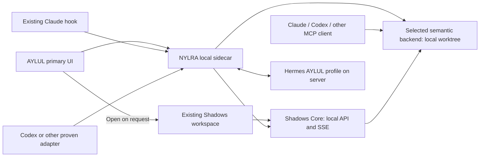

# AYLUL: local work context with a remote Hermes brain

Date: 2026-10-18.
Status: **Runtime/authority boundaries agreed in conversation. Integration details
remain a draft for review; product implementation and repository migration have not started.**

Document size review (over 300 lines): this file's single responsibility is the
interruption-to-direction design. Its evidence, operating modes and acceptance
gates stay together so a reader can assess the proposed flow without a second
competing design document. Detailed execution steps live in the linked plan.

## 1. Intent

AYLUL explains an interruption in ongoing development using the actual last message,
the correct project's plans/contracts, and bounded source evidence. It should not
spend a Planner turn merely to translate or explain something already available.
The person can then send a direction to the correct agent session. This must also
work for development outside Shadows' Planner workflow.

The user selected personal use first. Reuse Hermes for model orchestration and
memory; retain NYLRA's tested Claude hook/sidecar; use Shadows' existing services
when needed. Neither NYLRA's sidecar nor its hook becomes an AppCore service.
Core means the existing local Rust Shadows application throughout this proposal.
Section 14.4 is authoritative for the scope of `AppCore`: it composes Shadows
services only. AYLUL, code intelligence and Hermes each have their own composition
root; no new umbrella `AppCore` is introduced for the whole product family.

Confirmed by the human during this planning turn: **AYLUL is the primary UI.**
When the person chooses Shadows, load the existing Shadows workspace on demand.
Keep the NYLRA Tauri main shell and companion; stage the built Shadows UI as an
optional workspace surface. The proposed native implementation opens a dedicated
`shadows` window only on that explicit action, keeping AYLUL's main conversation alive.
This does not require a sidecar rewrite or a repository merge before a working journey.

## 2. Evidence inspected

These are source observations, **not new test or device acceptance results**:

Later execution is recorded separately in the dated
[Serena baseline](../../evidence/code-intelligence/2026-10-18-serena-baseline.md).

| Repository snapshot | Inspected owner | Observation |
|---|---|---|
| Shadows `6c17249`, branch `docs/web-codemap` | `crates/shadows-core/src/events/{contract.yaml,mod.rs}`; `web/src/stream/use-thread-stream.ts` | Per-thread durable replay and live events exist. `ThreadEntryAppended` carries an ordinal/kind, not the full last answer. Terminal operation events exist. |
| Shadows, same snapshot | `crates/shadows-core/src/code/{contract.yaml,mod.rs}`; `crates/shadows-http/src/code.rs` | Tree-sitter index exists; references match names, not resolved symbol identity. Keep this explicitly weaker than LSP references. |
| Shadows, same snapshot | `harness/setup.rs`, `shadows-agent/src/acp.rs`, `turns/contract.yaml` | Managed Claude sessions receive MCP over ACP; send, queue, Send now and stop already have owners. These are not attachment APIs for arbitrary external CLI processes. |
| Shadows, same snapshot | architecture section 1.7 and approval section 24.6 | NYLRA projection/sharing and external authority are specified; these sections explicitly have implementation/authority gaps. Existing project MCP grants include writes and are not read-only assessment grants. |
| NYLRA `2b04273`, branch `codex/aylul-relay-client` | `apps/desktop/sidecar/src/{protocol.ts,handlers.ts,rpc.ts}` | Claude event ingestion and approval/rule calls exist. No send-prompt handler exists in the inspected handler table. |
| NYLRA, same snapshot | `sessions/session.ts`, `hooks/route.ts`, associated contracts | `project_dir` wins over changing cwd; Stop saves at most 2,000 characters. Stop alone means waiting, not a proven blocker. Session type currently names `claude_code` only. |
| NYLRA, same snapshot | `src-tauri/src/{lib.rs,windows/mod.rs,sidecar/contract.yaml}` | Tauri owns sidecar lifetime and native windows. Closing its input stops the sidecar. It is not yet an independently installed background service. |
| shadows-backend `e4d178a`, branch `backend/account-chat` | `docs/codebase/README.md`, conversations/laptop-link/brain contracts | Identity, relay, chat/provider work already exists. `aylul-brain` is currently a text-stream package without tools or storage. Do not describe this repository as empty or delete it. |
| Hermes `ccc695635094d7615373db267b77f894d978b1a0` | desktop guides; `apps/shared/src/{json-rpc-gateway.ts,gateway-contract.generated.ts}`; `tui_gateway/ws.py`; `tools/mcp_tool.py` | A shared JSON-RPC/WebSocket runtime and MCP client exist. Generated wire contracts exist. Remote deployment and a NYLRA integration were not exercised. |

Shadows MCP and Rust LSP navigation tools were unavailable in this chat. Source
inspection used the existing maps/contracts followed by scoped file reads/search.
The pasted VS Code extension instructions are reference material, not project rules.

## 3. Research conclusions

The human now explicitly requested downloading and using Serena as the baseline
for learning and comparison. This adopts a research tool, not its code/license as
the permanent product implementation. Evaluate reuse of existing language
servers/client libraries; do not build semantic language analysis from scratch.

1. **Serena can run as a separate local process**, with its language-server backend;
   it does not require VS Code. Rust and TypeScript support are documented, but
   Windows behavior on these repositories must still be measured. This establishes
   a candidate, not a requirement to ship Serena. [S1, S2]
2. **Do not transplant the VS Code extension.** Its advertised symbol and
   diagnostic functions delegate to a running VS Code workspace. The pasted
   extension is not Serena itself. It can remain an optional developer tool.
3. **If Serena is selected, fix its worker to one canonical worktree.** A shared worker has mutable
   active-project state; different roots must not switch that state underneath
   simultaneous requests. Start with one active root; add a second bounded worker
   when the two-project test needs it. No fleet scheduler. [S2, S3]
4. **If Serena is selected, select the tools interface explicitly.** Current Serena main defaults to REPL.
   REPL operation filtering is not a restriction on submitted Python code. For
   explanations use a server-enforced fixed read-tool set and no shell, editing,
   project switching, memories, or REPL tools. [S4, S5, S6]
5. **Do not promise token savings yet.** Symbol retrieval can reduce returned
   context, but actual total tokens, latency and correctness require paired
   measurements. No percentage claim without the evaluation in the plan.

The pinned `src/serena/tools/symbol_tools.py` was also inspected: `FindSymbolTool`
supports file/directory scope and optional body retrieval; reference lookup names
both a symbol path and its source file. This is useful evidence retrieval, not
automatic understanding of which agent or business task stopped. [S11]

### Backend selection before implementation

| Candidate | Reuse | Question the probe must answer |
|---|---|---|
| Serena process | Complete semantic tool layer | Accuracy, lifecycle, licensing/distribution and operational cost |
| SolidLSP library | MIT language-server client infrastructure | Standalone dependency/license boundary and effort to expose the few needed operations |
| Existing native LSP client integration | Language servers such as rust-analyzer plus an existing client library | Client maturity, Windows process handling, references accuracy and lifecycle cost |

Choose one implementation behind the application-level `queryCode` operation.
Do not build three adapters, a plugin framework or another compiler/index engine.
The intended reusable capability is a **standalone code-intelligence service**:
its lifetime and installation do not require Core, Planner, AYLUL, or an editor.
Core, NYLRA and direct coding-agent clients consume it rather than each owning a
semantic stack. Any integration with Core's code service needs its own amendment
to the existing section 15 owner; preserve the parser-only `shadows-index` crate
boundary until such a change is explicitly designed.

Current source correction: `crates/shadows-index/src/languages.rs` registers Rust,
TypeScript, TSX and JavaScript. The reference-accuracy limitation is name-based
matching, not simply a lack of non-Rust grammars. Adding grammars alone does not
provide resolved semantic references.

Research snapshot: Serena upstream HEAD resolved by `git ls-remote` to
`d9e4c796fae0207ba6848d1df4b331122a5567b5`. The inspected main metadata reports
`2.0.1.dev0`. Pin the experiment to that commit or select a released version in
the probe and regenerate its tool manifest. Do not deploy moving `main` or `latest`.
The upstream README records the Serena application as GPL-3.0-or-later and
SolidLSP as MIT. Record provenance and review packaging obligations before distributing
Serena; this proposal does not decide licensing consequences. [S1]

## 4. Ownership and topology

| Owner | Sole authority in this journey |
|---|---|
| Core | Project/plan state, managed Planner turns, its journal and command outcomes |
| Local sidecar | Agent-session binding, disclosure consent, bounded context, dispatch receipts |
| Standalone code-intelligence service | Workspace-scoped source queries and language-server lifecycle; no plan or session authority |
| Hermes AYLUL profile | Explanation text and proposed directions from the evidence supplied |
| UI/native host | Deliberate person actions and presentation; native companion lifecycle stays native |

### Runtime composition and data ownership

The [section 14.4 clarification](../../superpowers/specs/2026-09-26-application-core-design.md#144-shadows-core-appcore-and-its-services)
owns Core's scope. The [standalone service spec](../../code-intelligence/specs/2026-10-18-code-intelligence-service-design.md)
owns its separate runtime. This is the integration view:

| Concern | Owner | Other runtimes receive |
|---|---|---|
| Plans, project rules, command outcomes | Core's existing services/database | Scoped API/MCP responses and journal events |
| Observed CLI sessions, attention items, dispatch receipts | AYLUL local runtime/store | Bounded projections; source identity is retained |
| Workspace semantic state and language-server workers | Independent code-intelligence runtime | Versioned query results and status |
| Model context and persistent assistant memory | Hermes AYLUL profile | Model responses and tool requests |
| Window navigation and unsent UI drafts | Desktop/UI owner | Explicit user actions, not fabricated business outcomes |

Each runtime owns its own composition and transactions. There is no shared
application singleton, cross-process SQL access or transaction spanning local
Core, sidecar and Hermes. A consumer stores identifiers/cursors/receipts as needed,
not another owner's mutable tables or a second version of its rules.

### Independent lifecycle

| Action | Expected scope |
|---|---|
| Close the optional Shadows workspace window | Close that view; AYLUL remains usable |
| Stop Core | Its existing managed-turn shutdown runs; direct CLI observation and the shared code service remain independent |
| Quit AYLUL | Its sidecar follows current native lifetime; independently launched shared code intelligence remains usable by other clients |
| Stop shared code intelligence | Source queries report unavailable; neither Core nor CLI sessions are killed |
| Lose Hermes connectivity | Local attention/state remains visible; explanation/send status reports the actual outcome instead of switching brains silently |

A convenience launcher may start an absent component, but must distinguish a
child it created from an already-running shared owner. It may not terminate the
latter when its own window exits. No universal supervisor/DI container is required.

### Code placement without an immediate repository move

For now, keep Core and `web/` in Shadows; keep Tauri, hook, sidecar and AYLUL UI
in NYLRA; keep upstream Hermes and the Serena reference outside product source.
The service package gets an independent manifest/build/start boundary after its
baseline selects a language/location. The monorepo sketch is a possible later
placement, not permission to move files or rewrite the existing native components.
Its source map/contract documents real modules only as they are implemented.

### Vision, document and acceptance transition

The [transition plan](../plans/2026-10-18-nylra-transition.md) owns the disposition
ledger and relocation procedure. NYLRA's existing Vision/delivery/source-placement
owners are amended in place; completed plans, dated evidence and tested behavior
are carried forward with their limits. No repository merge starts by discarding
the old documentation/test tree or by pretending the changed vision was always
the measured implementation. Initial hashes cover 143 selected tracked files.

### Independent character/avatar domain

The character's appearance/renderer/motion/studio remain owned by NYLRA's
`docs/character/` and `features/companion/`. Native window behavior remains owned
by `docs/native/` and `src-tauri/src/windows/companion/`. These are independent
design responsibilities, not another mandatory runtime or an AppCore service.
The new assistant UI and Hermes integration do not redesign the avatar or turn
its animation state into authority about task success, approval or execution.
Preserve its optional visibility, failure isolation, production/studio separation
and existing native render-permission/no-focus-steal tests during integration.

A server proxy, if needed, forwards authenticated bounded messages; it owns no
second plan engine or code index. For the personal pilot, use an explicit private
network route to the local bridge. No public Core or raw Serena listener is required.
Domain/HTTPS setup for Hermes is separate deployment work.

Hermes must not read Core's SQLite or the laptop filesystem directly. Expose only
the local bridge's assessment tools to its AYLUL profile. Do not pass the existing
write-capable project MCP token to an explanation-only model. Disable unrelated
Hermes shell/file/control tools for that profile and verify the actual tool surface.

## 5. Source identity before retrieval

Two operating modes are intentional. In the Core workflow, consume the explicit
project/thread/operation/plan/task/executor relationships that Core actually owns;
do not rediscover them through Serena. In direct Claude/Codex use, no Shadows
executor role or plan association is assumed: use the known CLI session/root and
available code context. Unknown is a legitimate value, not a failed search for a
Planner relationship that never existed.

Every observed session has a stable local `sessionKey`, source `agent`, `deviceId`,
`sourceSessionId`, connection generation and a canonical worktree root. Optional
Core project/thread/operation IDs and a plan/task binding are references, not guesses.

- Register the worktree from the managed session or the verified hook project root.
  A nested cwd cannot silently replace it. Git worktrees of one repository are distinct.
- Bind an external session to a Core task only through an explicit relation from
  the owner or a person-selected association. No matching by title, recency or model guess.
- Without a Core task, still explain from the external session, code map, contract
  and source. Report that no authoritative plan/task relation is available.
- If a root or target is ambiguous, retain the event but request selection before
  source disclosure or command delivery. No broad scan across all user repositories.

## 6. Interruption to explanation

1. Subscribe independently of whichever thread pane is visible. Persist the last
   consumed durable Core cursor; reconnect/replay does not create repeated alerts.
2. A completed turn is a trigger to inspect its answer, not proof that work failed.
   Explicit blocked/request-input status, permission needs, or a user asking for
   explanation can produce an attention item. Plain completion can stay silent.
3. Resolve the last **committed** answer by event ordinal/message identity. Core
   live deltas are not the durable answer. For Claude hooks, fetch a bounded tail
   of the indicated session transcript only after checking that it belongs to the
   selected session/root. Never follow an arbitrary supplied path.
4. Keep the current 2,000-character field as a preview. Add a separate full-message
   reference/digest and a bounded read path; truncation is explicit. Do not replace
   it with unlimited transcript replication.
   This is a limit of the inspected NYLRA hook preview, not a limit of Hermes or
   Core's stored replies. An integration using another authoritative message source
   need not route the answer through this preview field.
5. Build an evidence bundle: session/turn identity, relevant answer, explicit
   task/plan references, contract/spec excerpts and the smallest useful code slices.
6. Start with the code map and owning contracts. Query symbols only within that
   registered root, expand references one bounded step at a time. Return multiple
   candidates instead of choosing an identically named symbol arbitrarily.
7. Send the bundle to Hermes for an Arabic explanation with clickable local sources.
   Separate observed facts, inference and unknowns. Explain the blocker, consequence
   and available choices; do not ask the Planner merely to paraphrase its message.

Proposed pilot bounds: at most 8 source excerpts, 120 lines per excerpt, 64 KiB
UTF-8 total evidence, 10 semantic queries and 20 seconds retrieval time per attempt.
Include context documents in the byte limit. Return omissions/truncation explicitly.
These are conservative pilot settings to measure, not established performance facts.

Each citation carries root identity, relative path, symbol if known, line range,
content digest and capture time. Line numbers are presentation coordinates, not
durable symbol identity. Re-read changed sources before reusing an explanation.
Cache by evidence digests, selected root and plan revision vector, not prompt text alone.

## 7. Read boundary and lifecycle

Serena-specific settings below are conditional on its selection; other backends
must satisfy the same read, scope, budget and lifecycle boundary through their
own supported mechanisms. No new provider is adopted by writing these settings.

- Project sharing is off until explicitly enabled. Core must enforce its own
  sharing/projection rule; sidecar consent does not silently complete section 1.7.
- Disclosure consent applies to sending selected code/context to the remote brain.
  The bridge filters configured sensitive files and recognizable credentials, but
  content filtering is not a guarantee against every secret embedded in source.
  Opt-out stops future reads; it cannot retract evidence already sent to a model.
- The local bridge validates root, operation and limits before calling the selected backend,
  then validates/redacts results before they cross the network. Recheck consent
  and current binding after awaits and before releasing each result.
- Exclude secrets, ignored configuration, `.git`, transcript stores and paths
  escaping via symlink/junction. LSP references outside the worktree are omitted
  unless another root is separately selected and authorized. Never retrieve real
  ignored `.env` contents during tests or investigation.
- Force `agent_interface: tools`, project `read_only: true`, and a fixed tool set
  such as `find_symbol`, `find_referencing_symbols`, `get_symbols_overview`,
  `get_diagnostics_for_file`. Add a bounded read helper only after verifying its
  path policy; use sidecar-controlled file reads for contracts/excerpts.
- Avoid repository activation commands/custom tool configuration; treat project
  configuration as input and verify the effective tool list after activation.
  `read_only` alone is not a sandbox; language servers can have their own build effects.
- First pilot has one selected root and one worker. A second worker is permitted
  for the concurrency acceptance case. The standalone service owns its language-server
  workers; a client timeout cancels its request, not another client's shared worker.
- Current Tauri Quit stops the NYLRA sidecar, not an independently launched
  code-intelligence service. Manual standalone launch is sufficient for the first
  independent package; an OS startup/service installer is a separate packaging choice.
  Core shutdown must not stop a service that direct coding clients still use.

## 8. Sending directions is a separate capability

Here, externally launched means started outside the process/session owner being
controlled; it does not mean a pre-Hermes architecture. Hermes replaces AYLUL's
reasoning engine. An existing Claude/Codex session still needs its own reachable
control mechanism. If a chosen owner already manages that session, use its proven
send path instead of adding another attachment bridge unnecessarily.

`queued`, `accepted`, `delivered`, `completed`, `failed`, `unknown` and
`unsupported` are distinct. Delivery is not task success. On an ambiguous disconnect,
inspect the receipt or show unknown; never blindly repeat a non-idempotent send.

| Session source | Initial control approach | Evidence required |
|---|---|---|
| Core-managed Claude | Existing Turns send/queue/Send now/stop through a scoped companion command entry | Correct project/thread, replay, busy handling and actual adapter turn receipt |
| External Claude using existing hook | Retain hook observation/approval; investigate supported wake/delivery mechanism on installed version | Real idle and busy terminal trials; hooks alone do not prove arbitrary prompt submission |
| Codex under a NYLRA-owned app-server connection | Native protocol `turn/start`, `turn/steer` with expected turn, `turn/interrupt` | Version-pinned local integration; no claim it attaches to a separately running GUI or CLI |
| Arbitrary already-running Codex/other CLI | Explicit capability discovery | Show unsupported until its own documented live control path is proven |

Current Claude docs describe `asyncRewake`, but support and acknowledgement on the
installed version are unverified. Current Codex docs describe app-server control;
WebSocket transport is experimental. Neither is proof of controlling an unrelated
already-running session. The probe must close this before promising seamless control. [S7, S8]

The local person can send an addressed, unmodified text direction directly without
an extra confirmation dialog. A Hermes-written rewrite remains a draft until the
person sends it. Privileged permission/plan/structure approvals continue through
their existing explicit confirmation owners; a model explanation is never approval.
Network-originated mutations cannot borrow Core's local-person identity: section
24.6's authority OPEN must close before that path is enabled.

## 9. Phasing and existing decisions

The first proof is an external Claude Stop plus a source-backed explanation in one
workspace, without a Planner model call. Next prove the managed-Core path and user
direction delivery. Codex/external idle control remains a first-class gated task,
not an unchecked promise. Complete the unified desktop journey after the data path works.

This proposal changes the preferred brain owner and client composition. Before
implementation, amend the existing authority owners in place: Shadows architecture
1.7, NYLRA's delivery spec/source-structure, and backend architecture if its scope
changes. Keep approval 24.6 authoritative. Do not silently supersede accepted specs
with this draft or create a parallel decision owner.

Keep `shadows-backend` and its existing data/code intact. The personal pilot does
not dispatch the same AYLUL turn through both its current chat engine and Hermes.
Select one brain connection. Multi-user signup, billing, phone, production automation,
general-purpose orchestration frameworks and replacing Core's code index are outside
this delivery. Physical repository consolidation follows the transition manifest
and acceptance, not a precondition or a hidden rewrite task. A replaced decision
is amended/retired explicitly; dated facts and completed acceptance do not disappear.

## 10. OPEN gates with closing triggers

- **G0 - Version/capability probe:** closes when pinned Hermes, Claude and Codex
  transcripts prove the operations used by this design on Windows. Semantic
  backend adoption is separately gated by G6.
- **G1 - Source sharing:** closes before real code is sent remotely, with owner-enforced
  opt-in, identity, revoke-during-read, and sensitive-path refusal tests.
- **G2 - Session control:** closes per adapter before its Send/Steer/Stop controls
  are enabled, with actual correct-session, busy/idle, disconnect and duplicate-send evidence.
- **G3 - Human authority:** closes before remotely originated privileged effects,
  with the exact actor/proposal/revision/replay checks required by section 24.6.
- **G4 - Host choice:** primary UI choice closed in this conversation: AYLUL first,
  existing Shadows workspace loaded on request. Packaged origin/capability behavior
  still needs the T7 native tests before declaring desktop integration complete.
- **G5 - Deployment/distribution:** closes before server exposure or redistribution,
  with authenticated network tests, dependency provenance and packaging review.
- **G6 - Semantic backend selection:** closes before a semantic dependency ships,
  with a compared retrieval fixture, Windows lifecycle evidence and reviewed
  license/dependency boundaries. Candidates are Serena, standalone SolidLSP and
  existing native LSP client integration; choose one. Core index expansion remains
  separate future work until its own owner-spec amendment is accepted.

## 11. Standalone package direction

The [independent service design](../../code-intelligence/specs/2026-10-18-code-intelligence-service-design.md)
is now the sole owner of package/lifecycle/workspace-query requirements. The
[baseline plan](../../code-intelligence/plans/2026-10-18-code-intelligence-baseline.md) defines the next
executable evidence work. AYLUL is a client of that package, not its composition root.
Serena is the installed learning baseline, not an already-approved replacement codebase.

**G7 - Standalone package contract:** closes before replacement implementation,
with an accepted package location/language, wire contract, workspace identity and
independent lifecycle test. The resulting task plan replaces T2's conditional
backend implementation details; this draft does not authorize building all options.

## Sources

- S1: [Serena README](https://github.com/oraios/serena) and
  [package metadata](https://github.com/oraios/serena/blob/d9e4c796fae0207ba6848d1df4b331122a5567b5/pyproject.toml).
- S2: [Running Serena](https://oraios.github.io/serena/02-usage/020_running.html).
- S3: [Project workflow](https://oraios.github.io/serena/02-usage/040_workflow.html).
- S4: [Tools and APIs](https://oraios.github.io/serena/01-about/035_tools.html).
- S5: [Configuration](https://oraios.github.io/serena/02-usage/050_configuration.html),
  [project template](https://github.com/oraios/serena/blob/d9e4c796fae0207ba6848d1df4b331122a5567b5/src/serena/resources/project.template.yml).
- S6: [Security considerations](https://oraios.github.io/serena/02-usage/070_security.html).
- S7: [Claude hooks](https://code.claude.com/docs/en/hooks).
- S8: [Codex app-server](https://developers.openai.com/codex/app-server).
- S9: [Hermes plugin boundary](https://hermes-agent.nousresearch.com/docs/developer-guide/plugins).
- S10: User-supplied VS Code MCP Server description and screenshot; assessed as
  evidence of an IDE-bound alternative, not tested extension functionality.
- S11: [Pinned Serena symbolic tools](https://github.com/oraios/serena/blob/d9e4c796fae0207ba6848d1df4b331122a5567b5/src/serena/tools/symbol_tools.py).
