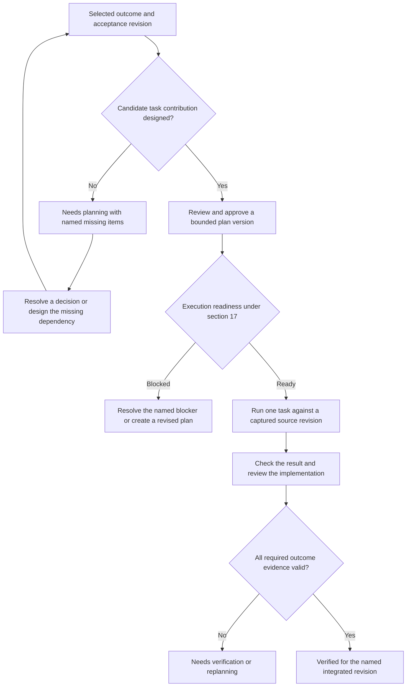

# Project structure, layers and planning depth

Status: draft for Mohammed's review, revised 2026-11-05. Nothing here is built.
The review amendments below are engineering proposals made under Mohammed's
request to improve this design. They do not record his approval of new APIs.

**Mohammed's decisions, 2026-11-05.**
- **No backward compatibility.** Every project made so far is test data.
  Old maps, plans and structure writes need no protection. The daemon must
  still start on an existing database; its migration may convert old rows
  crudely.
- **Shadows never writes `contract.yaml` after this change.** This holds for
  every project and standards version. Files already on disk are left
  alone.
- **Repository implementations live in backend infrastructure.**
- **The task view and Show phases (§6.2)** are approved as drawn.
- **The stack profile (§5.3, D1 to D4)** was left to the controller's best
  choice. It is recorded in §5.3 and closes the former OPEN 2.

**Words used with one meaning each:**

| Word | Meaning |
|---|---|
| **Planning step** | Shadows' guided steps: Idea, Vision, Map, Structure, Roadmap, Plans. |
| **Project stage** | A roadmap outcome of the person's project, such as "Stage 1: working support loop". |
| **Delivery slice** | A numbered piece of this work in the plan, slice 1 to slice 9. |
Mockup: https://claude.ai/artifact/No9kfXkwK12wctXundandy (four screens).
Its source files are in
[2026-11-05-structure-and-depth-mockup/](2026-11-05-structure-and-depth-mockup/README.md).
Plan: [../plans/2026-11-05-structure-and-depth.md](../plans/2026-11-05-structure-and-depth.md).

## 1. Why

Two test projects showed that Shadows does not hold the structure of the
projects it plans.

- **testing55 (Haiku 5.5).** The standards say the backend is "one core;
  every operation is a method of one service". The Planner read that
  literally. Every folder (`app`, `config`, `routes`, `migrations`, `lib`,
  `dashboard`, `telegram`) landed in the project root, as one application.
- **testing56 (Sonnet 5.5).** The same standards (base v1, no additions)
  gave one folder per part. That came from the model, not from Shadows. The
  only folder rule Shadows holds is that two parts' folders do not overlap
  (`MapRules`, `map_rules.rs`).
- **No section has an inside.** In both projects the backend is one block:
  no layers, no modules, and Telegram, Firebase and Mercure all sit inside
  it. The database part is a `contract.yaml` and nothing else. It has no
  migrations folder, no schema, and no connection code beneath the others.
- **A plan does not say how deep its part was designed.** "T1: Database
  tables for the support loop" lists five acceptance items. The tables,
  columns and relations were never discussed or drawn. What Shadows calls a
  plan is closer to a map of work than a plan of code.
- **`contract.yaml` files duplicate Shadows.** Shadows writes one per part.
  Each file is a copy of the map, and Shadows is the source anyway.
- **Bug.** Map approval accepted a part with no folder (Frontend). Create
  structure then refused it ("part has no folder: Frontend"). These are two
  paths with two answers for one rule.

## 2. Goals

1. **The standards name each section's layers as roles, with the direction
   of dependency.** They do not name folder layouts. A model cannot read
   them as "one block".
2. **Every part and every layer owns one folder, inside its parent's
   folder.** Shadows refuses a map that breaks this, at proposal time.
3. **The database part owns persistence foundations.** It holds the schema,
   migrations and connection. Repository implementations live in the
   backend's infrastructure layer (Mohammed's decision, 2026-11-05). A
   change of database is intended to stay in these owners. A change in
   transaction or consistency semantics still needs an impact review of
   the use-case contract.
4. **The person sees the project as a drawing at every depth:**
   project → part → layer → element. Clicking zooms in. A breadcrumb or
   Escape zooms out.
5. **Shadows reports planning coverage for a selected outcome,** with
   missing decisions and evidence visible. Layer detail is a separate view.
6. **A task names the elements it builds, and it has phases.** A phase can
   wait for a phase of another task.
7. **Shadows stops generating per-part `contract.yaml`,** for every project.
   An agent retrieves the same obligations through scoped MCP reads. Files
   already on disk are not deleted.

## 3. Non-goals

- Shadows does not dictate folder names per framework. The standards give
  roles; the map stage maps roles to folders with the person.
- No code generation. Elements are names, files and signatures, never
  bodies.
- No new stage in the stage line. Depth work happens after the map, through
  cards, like every other write.
- Not every architectural pattern becomes a rule. The base standards hold
  the few that, broken, cost the most (section 5).
- **No compatibility layer for existing projects.**
  - There is no v1/v2 adoption flow. Base v2 replaces v1 for every project.
  - Legacy folder lists are not kept losslessly.
  - No renderer version is pinned for old structure writes.

## 4. Anti-goals

These would count as failure even if everything technically works:

- **A plan longer than the code it describes.** Elements stop at the file
  and its symbols.
- **Clean Architecture forced word for word on a stack that does not fit
  it.** For example, a separate entity class beside every Laravel Eloquent
  model. The standards fix roles and dependency direction, and nothing more.
- **A depth number the model can raise by saying so.**

## 5. The model

Parts already nest freely. Layers and elements add detail to those same
identities. A roadmap outcome selects the delivery scope across parts.

```text
Project
 └─ Part          a section, which may contain child parts
     └─ Layer     a role inside a part, from the standards' catalog
         └─ Element  a named thing in a layer: table, entity, use case,
                     endpoint, screen, adapter ... with its file and symbols
Outcome          acceptance items, related parts, coverage and linked plans
Plan version
 └─ Task          names the elements it builds or changes
     └─ Phase     an ordered step of the task; may wait for a phase elsewhere
```

### 5.1 Parts

- **They stay as they are:** title, responsibility, design, kind and serves.
- **Every part has exactly one root folder.**
  - A child part's folder lies inside its parent's folder.
  - One `MapRules` policy checks proposal, approval and person edits. It
    covers reparenting and the descendants a changed ancestor affects.
    Structure rendering calls the same policy before its disk checks. There
    is no second reading of folder ownership.
  - The rule checks the whole candidate map. An old test map that breaks it
    is refused on its next write, with a message naming the part.
  - A grouping part can contain physical child parts without duplicating
    their required layers. A part with a child of its own kind is a grouping
    part, for example a `frontend` holding `web` and `mobile`. It needs no
    layers, and nothing new is stored (D3).
  - **Migration.** Slice 2 turns `folders` into `folder`:
    - it keeps the first stored folder;
    - an empty list becomes the part's slug;
    - layers start empty.
    This is crude on purpose, because the data is test data. The daemon
    still starts.
  - **Paths.** Paths are project-relative canonical paths throughout the API,
    and layer paths include the part prefix. Ownership compares normalized
    path segments using the existing Windows case rules, never raw prefixes.
- **New kind: `integration`.** It is for adapters to outside services such
  as Telegram, Firebase and Mercure. It is optional; a project may also
  keep them as a layer of the backend (5.2).
- **The contract head (header and rule ids) stays in Shadows.** It is shown
  on the part page and given over MCP, but no longer written to disk.

### 5.2 Layers: the standards catalog (base v2)

The standards file gains a `layers` list per kind. Each layer has:

- `id`
- `role`: one sentence
- `required`: true or false
- `elements`: the element kinds it holds
- `may_use`: the layers it may depend on

Dependencies point inward. The catalog is data, so a project's standards
additions can add a layer or make one required.

**Backend**

| Layer | Role | Required | Elements | May use |
|---|---|---|---|---|
| `domain` | Business rules and the state they guard | yes | entity, value, rule, domain_event | (nothing) |
| `application` | Use cases: one operation each, and the ports it needs | yes | use_case, port | domain |
| `interface` | Receives HTTP/queue/console input and calls one use case | yes | endpoint, job, command | application, api.contract |
| `infrastructure` | Implements the application's ports: repositories over the database, and technical adapters such as mail, files and clock | yes | repository, adapter | domain, application, database.schema, database.connection |
| `composition` | Builds every module once and wires ports to implementations | yes | module | all backend layers, integration.adapters |

**Database:** persistence foundations, owned by modules through repositories.

| Layer | Role | Required | Elements | May use |
|---|---|---|---|---|
| `schema` | Tables, columns, keys and relations | yes | table | (nothing) |
| `migrations` | Append-only changes that produce the schema | yes | migration | schema |
| `connection` | How the application connects: driver, pool, transactions | yes | connection | (nothing) |

The layers are roles from the Clean Architecture explanation Mohammed
brought, not a fixed folder layout. A stack maps them at the map stage
(5.3).

**Api**

| Layer | Role | Required | Elements | May use |
|---|---|---|---|---|
| `contract` | The versioned contract the clients build against | yes | operation, schema_type | (nothing) |

**Frontend:** one part per client.

| Layer | Role | Required | Elements | May use |
|---|---|---|---|---|
| `screens` | What the person sees: routes and pages | yes | screen | features, design_system |
| `features` | A feature's interactions and its state | yes | feature, store | data_access, design_system |
| `data_access` | The only code that calls the api | yes | client_call | api.contract |
| `design_system` | Shared components and tokens | no | component | (nothing) |

**Integration**

| Layer | Role | Required | Elements | May use |
|---|---|---|---|---|
| `adapters` | Talks to one outside service and implements a backend port | yes | adapter | backend.application (ports only) |

**Modules.** The backend also holds modules (bounded contexts), such as
`tickets`, `queue` and `agents`.

- A module runs across the domain and application layers.
- Each table in `database.schema` names the one module that owns it.
- The base rule (S1, kept) says a module reads only its own tables and asks
  the owning module for anything else.
- The `composition` layer is the project's AppCore. It is the one place
  that builds every module. It is a layer, not the whole backend: this is
  the "one core" sentence said the way it was meant.

**Rules kept from base v1:** S1 to S6. Their texts change only where they
named folders or contract files. S3 reads: "Every part has a contract head
in Shadows". Base v2 replaces v1 for every project.

**New rules:**

- **S7. Dependency direction.** A layer depends only on the layers its
  `may_use` lists. S7 is checked between layers, not parts.
- **S8. Ports.** The domain and application layers never name a database,
  framework or outside service. They declare a port, and an outer layer
  implements it.
- **S9. One folder.** Each part owns one folder. Each layer owns one place
  inside its part: a folder, or one path per module.

The catalog is one profile for every stack. A stack maps it through each
layer's place (§5.3, D1). Both a layered Laravel project and a
service-per-crate Rust project fit, and so does a mobile client, which uses
the same frontend layers as the web (D4). A required role's inapplicability
needs an explicit person-reviewed reason in the map (D2). An optional unused
role remains visible as unused. Project additions cannot silently weaken a
mandatory base rule.

`may_use` is permission, not a list of actual dependencies. Same-layer links
are allowed when their link kind and module ownership permit them, including
schema foreign keys. `backend.interface` may implement `api.contract` and
call `backend.application`. Cross-part references identify a concrete part
and layer, because a project can have several frontends or integrations.
Composition may wire the approved integration adapters as well as backend
layers. These permissions do not authorize another module's table access.
The S7 check validates declared design links. Source imports and runtime
behavior need their own checks under §17.

### 5.3 Layers in a project

**At the map stage**, the map card proposes each part with its layers:

- every required layer of its kind, plus the optional ones the person
  wants;
- each with its **place**: a project-relative path inside the part's
  folder, chosen for the stack (D1).
  - **One folder per layer** for a layered stack. Example for Laravel:
    `domain` → `backend/app/Domain`, `interface` → `backend/app/Http`,
    `composition` → `backend/app/Providers`.
  - **One place per module** for a stack that gives each module its own
    folder. The place holds one `{module}` marker. Example for
    service-per-crate Rust: `domain` → `crates/core-{module}/src/model.rs`,
    `infrastructure` → `crates/core-{module}/src/store`. A pattern may name a
    file or a folder. Shadows creates nothing for it until modules exist as
    elements. An element is still recorded once, in its own layer, so no
    stack is forced to duplicate entity classes.
- A required layer the project does not use is marked **not used**, with a
  written reason and an empty place. The person approves the reason with
  the map card (D2).

**Shadows refuses the map** when:

- a required layer is missing and not marked not used;
- a layer is not in its kind's catalog;
- a place lies outside its part, or inside a child part's folder;
- two layers share a place;
- or a not-used layer has no reason.

The values sent and stored are project-relative, for example
`backend/app/Domain`. A form may display them relative to `backend`.

**Create structure writes:**

- one folder per part, and from slice 2 one per layer;
- the starter files from the card;
- and one root `SHADOWS.md`. That file says Shadows is the source and how
  to reach it over MCP. Nothing per part, and never a `contract.yaml`.

**An unfinished write from before the update** is a stored structure intent
whose planned files include generated contracts. It is not resumed. Shadows
cancels it with the message "A structure write from an earlier version did
not finish. Press Create structure again." Files already on disk are never
removed.

Root instructions name only tools available in the shipped slice, with a
readable way to report unavailable MCP rather than guess ownership. The
reserved-file rule and the Planner's map instructions say the same thing.

### 5.4 Elements

An element is the smallest thing Shadows plans. It has:

- a stable project-scoped id and immutable approved revisions;
- `kind`, from its layer's catalog line;
- `name`;
- `summary`: one sentence;
- `module`: backend and database elements only;
- `fields`, depending on the kind:
  - a table has columns (name, type, null, default), keys, and relations
    to other tables;
  - a use case has input, output and the ports it calls;
  - an endpoint has its method, path and the one use case it calls;
  - a screen has its route and the features it shows;
- `location`: a source location inside its owning layer, or a logical
  location with an explicit implementing element. A table is logical and
  points to its migration elements. It does not claim a migration file
  under the schema folder. Contract operations can name an artifact and
  JSON pointer. Source symbols use qualified names and language.
- `symbols`: names and signatures when meaningful for the element kind;
- `links`, to other elements:
  - `uses`;
  - `implements` (a repository implements a port);
  - `reads` and `writes` (a repository reads and writes a table);
  - `calls` (a client call calls an api operation).
  Shadows refuses a link whose direction breaks S7.

**Elements are written through cards,** like the map:

- The Planner proposes with `element_propose`.
- The person approves with the button, or asks the Planner to approve with
  `element_approve`.
- A card may carry many elements. For example, the support-loop tables come
  in one card with their relations.

Approval validates the complete candidate batch, including references within
that card, in one transaction. Mutual foreign keys may be legitimate. Their
existence does not imply a scheduling cycle. Proposals pin the effective
standards, map and affected element revisions and become stale on a relevant
change. They carry CommandId, versioned normalized fingerprint and authority
under §24. A lost response replays the same result. A new proposal cannot
overwrite a concurrent approval.

Renames retain identity. Removal retains a tombstone and historical content
for frozen plans. `module` references an explicit module identity in the
project, with one declared owning module per table. A small backend can use
one default module. Missing ownership is a planning blocker. A table relation
records a data constraint, while repository reads/writes enforce S1 ownership.

An API element references the existing §18 agreement and operation at an
exact version. It does not introduce a second authoritative API definition.

### 5.5 Depth

Shadows computes planning detail from approved element revisions. These
states describe the recorded elements, not completeness of the whole layer.

| State | Holds when |
|---|---|
| 0 Not recorded | No approved element is recorded for the selected scope. |
| 1 Designed | Required kind-specific fields, ownership and links resolve at approved revisions. |
| 2 Implementation specified | The element has its required source/artifact location or implementing elements, interface, relevant failure behavior and checkable obligations. Symbols are required only for source kinds. |

**What is computed from the states:**

- **A layer's detail** shows element counts by state and unresolved items.
  Empty optional layers are unused. A single designed table cannot make a
  whole required layer complete. Never derive 100% from an unknown inventory.
- **A part's summary** is shown on its map node and its page, in plain
  words, for example: "8 elements described, 5 specified for
  implementation, 3 need decisions; the full list of elements is not
  confirmed". This answers "how much of this part is planned" without a
  made-up percentage.
- **The next action**, supplied by the later Plans coverage read, is selected
  from blockers of the chosen outcome, with
  a reason and stable target ids. It might be an API contract, a policy
  decision or a missing test. Dependencies do not impose database-first work.

Code observation is independent and says `found`, `missing`, `ambiguous`,
`stale` or `unsupported`, with source revision/digest and index coverage.
Finding a symbol cannot establish `Built` or `Verified`. The current index's
name-matched references are candidates, not a proven call graph. Execution,
verification and review remain §17's separate records.

### 5.5.1 Outcome coverage: is a project stage fully planned?

Delivered in its own slice (6), after task bindings exist. The planning
step, the project stage and the delivery slice are different identities
(see "Words" at the top). The UI always labels which it shows.

For a selected outcome revision, record a coverage row per stable acceptance
item. A row links the required element revisions, task acceptance items at
exact plan versions, relevant agreement versions and any unresolved question.
It records explicit exclusions/deferred work with a reason and who accepted
them. Deferred required acceptance still blocks this outcome until its scope
is explicitly revised. Removing and re-adding a criterion never reuses its id.

Coverage edits are revision-checked commands with the same project authority
and replay rules as workspace edits. A Draft can propose bindings to its own
task acceptance items. Approval validates the candidate plan and coverage
together, then pins the resulting frozen version atomically. It does not
require that this candidate was already frozen. A stale criterion or plan
revision refuses the whole command. Existing approved coverage stays readable.

Approval validates the candidate's assigned coverage and design dependency
closure. It does not require every other plan for the outcome to be frozen.
Bindings to other Drafts remain provisional and cannot certify their portion
of coverage. An outcome can therefore have an approved backend plan while
its frontend plan still needs design. It remains Needs planning until all
required portions have reviewed coverage and approved plan bindings. Each
new task identifies its assigned criterion contribution, or the explicit
non-element task reason under §5.6. Execution readiness separately waits for
required upstream results. Two valid plans can be approved in sequence
without granting either premature execution readiness.

| Report | Required facts |
|---|---|
| Needs planning | A criterion has no coverage, a required decision is open, or an element/dependency is unresolved. |
| Planning covered | Every required criterion has reviewed coverage, implementation-specified elements and approved plan bindings for all required contributions. This proves coverage of the declared scope only. |
| Ready to run | §17 readiness succeeds for the selected frozen task and current execution binding. Until execution exists, show availability as unsupported. |
| Needs verification | Work is reported or observed, but required checks, review or integrated acceptance evidence are missing. |
| Verified for revision | All required criteria have valid checks and required review on the integrated result for the named outcome and plan versions. |

The first coverage release implements the first two reports and explains
that execution evidence is unavailable. It never makes up task completion.
Later §17 delivery supplies verification facts, including a browser journey
when required by the outcome. Coverage is a reviewed assertion about scope.
Shadows detects missing rows and stale references but cannot prove a human
or model remembered every real-world requirement.



Execution and evidence nodes in this diagram are later §17 delivery.

A relevant criterion, element, contract or source change shows `Needs review`
with the affected rows. Historical verification stays true of its old result.
Unrelated future work does not reopen a completed outcome. Reusing evidence
for a changed scope requires an attributable review of that change.

Example for a support loop, an approved schema and backend tasks still leave
"the customer receives exactly one reply" uncovered until its messaging,
retry behavior and end-to-end check are assigned. Stage 2's analytics need
not be designed before Stage 1 can run.

### 5.6 Plans, tasks and phases

**A task gains element bindings:** stable ids, approved revisions and each
binding's access (`read`, `create`, `change` or `remove`).

- Element locations suggest `reads` and `writes`. Tests, manifests,
  migrations and generated files often require additional paths, so the
  task author reviews and freezes the full scope. Reading a port never
  grants permission to write it. Frozen paths do not follow a later move.
- **Approval gate.**
  - **From slice 5:** a plan version cannot be approved while a task:
    - names an element that is not "implementation specified" for its
      declared change (blocker `element_not_specified`);
    - or references stale revisions.
  - **From slice 6:** coverage assigned to this candidate must also be
    resolved.
  - The blocker names the item and a next action.
  - Approval stays distinct from readiness to execute (§17).
  - Only the selected outcome's dependency closure is required, not every
    element in the project.
- **Tasks without elements.**
  - Plans made before this change are test data. They stay readable and
    are never certified as covered.
  - A new element-based task cannot bypass the checks by supplying
    `elements: []`.
  - Documentation, investigation and verification tasks may use a reviewed
    non-element task kind, with explicit paths, acceptance and a reason.

**A task gains `phases`:** an ordered list. Each phase has:

- a stable id, display `number`, `title`, `goal` and acceptance item refs;
- the subset of the task's elements it touches;
- and `waits_for`, a list of `{task, phase}`. The task may be in this plan
  or, with its plan and exact version, in another plan of this project. Draft browsing may
  offer the latest approved target, but approval freezes the target version
  and phase identity. Existing §16.7 task links keep their current semantics.

**Phase rules:**

- A task's acceptance items still decide when the task is done.
- Phases give the order inside the task.
- Ordered phases imply completion-to-start edges. `waits_for` also means
  prerequisite completion before this phase starts. Existing task-level
  `needs` and `completes_after` remain constraints. One event graph checks
  all of them, using the current start/complete model in `core-plans`.
- Phase links never form a cycle across the combined graph. A refusal names
  the complete offending path. Missing targets remain visible blockers.
- Phase numbers are display labels, not reusable identities. A phase rename
  or reorder cannot silently redirect a wait. A successor plan version
  requires explicit adoption of any changed phase target.
- Phase status and evidence belong to execution records, when §17 supplies
  them. A planning checkbox or an agent's statement cannot satisfy a wait.

### 5.7 Conflict checks and change impact

Before approval check unknown/stale references, required agreement adoption,
ownership violations and the combined dependency graph in one snapshot.
Before execution §17 rechecks readiness against the captured repository.
Compare full normalized read/write scopes as well as element ids. Different
symbols can share a file, and disjoint files can share a generated schema,
lockfile, migration order or build directory. Such shared resources require
an explicit ordering edge or a blocking diagnostic.

The first executor remains serial. These planning checks detect known
conflicts and report incomplete information. They cannot promise that no
semantic conflict exists. Independent review and checks on the integrated
result remain necessary. Safe parallel work waits for Shadows' own roadmap
(its Stage 8), which is not a project stage of the person's project.

## 6. What the person sees

The mockup shows each view with data from the testing56 support system.
Its labels and arrows must be updated to this revision before implementation.
The task graph and Show phases behavior below retain Mohammed's decision.

### 6.1 Navigation and the next decision

Keep one project workspace with the existing theme tokens and components.
Use these destinations consistently across full-page and conversation views.

| Destination | First question answered | Main action |
|---|---|---|
| Vision | What are we building and what is excluded? | Review an item |
| Roadmap | Which outcome are we delivering, and what is missing? | Resolve the next coverage blocker |
| Project map | Who owns this part of the system? | Open a part or find an element |
| Plans | What approved work can happen next? | Inspect a task and its prerequisites |
| Contracts | Which participants agreed to which interface? | Inspect impact or explicitly adopt a version |
| Standards | Which rules and layer catalog apply here? | Review the rules and layers |

Roadmap is the progress view. Project map is the ownership view. Both link
to the same records. A return visit restores the last selected outcome and
view, and an empty project starts at Vision. Show the active planning anchor
separately from the item being browsed. Browsing does not retarget a session.

The outcome page shows, in order, its intended result and scope revision,
acceptance coverage rows, actionable blockers, and related plans/parts.
Each blocker has a reason, affected ids and an action such as Design missing
element, Agree contract, Add task, Review change or Inspect evidence. A
"Continue planning" action opens an anchored draft with the selected blocker.
It does not automatically submit a message or approve a proposal.

### 6.2 Drawings and detail

1. **Project map is a canvas.**
   - Parts are nodes; edges aggregate declared element dependencies between
     concrete parts. Before elements exist, say "Dependencies not recorded".
     An optional Allowed dependencies overlay is dashed and clearly labelled.
   - Each node shows its kind, folder and the part summary from §5.5.
   - A persistence-oriented layout may place database at the bottom. Edge
     meaning and arrowheads remain explicit and independent of position.
   - "Served vision items" shows only the items the part serves, with an
     Add button.
2. **Part view:** a navigable layer list with counts is always available.
   Backend can also use rings, domain in the centre.
   - Each ring shows its folder, depth state and element count.
   - Rings are conceptual. Interface and infrastructure are peers with
     distinct permitted targets; nesting them never grants a dependency.
   - A module filter follows its elements across layers without copies.
3. **Layer view: the elements as a diagram that fits their kind.**
   - schema: an entity-relationship diagram;
   - use cases: a list with their ports;
   - api: operations grouped by path;
   - screens: a route tree.
4. **Element panel,** opened by clicking an element:
   - its approved revision, fields and applicable locations;
   - its links;
   - the tasks that build it;
   - and its **trace**: declared relationships, with direction and link kind.
     Example: `tickets` table ← `TicketRepository` (backend
     infrastructure) ← `TicketStore` port ←
     `TakeTicket` ← `POST /tickets/{id}/take` ← agent app queue screen.
     Calls and storage links point toward their dependency. Implements
     points from implementation to interface. A trace labels incomplete
     paths and distinguishes declared links from source observations.
5. **Plan view and task view.**
   - The plan stays the graph it is today, and each task card also shows
     its element chips.
   - Clicking a task opens the **task view**: the same kind of graph, one
     level down. Its nodes are phases, drawn as task cards are. The task
     itself is the start node, and the edges carry labels. The view keeps
     the legend, zoom controls and minimap.
   - A phase of another task that this one waits for, or that waits for
     it, appears as a dashed node with its task number. Clicking it opens
     that task's view.
   - **Show phases** is a button in the plan header, beside Versions. It
     opens every task at once, in the same graph:
     - each task becomes a frame titled with its number and title;
     - its phases sit inside the frame as cards, each with a badge such as
       `T3 · P2`, so every phase shows the task it belongs to;
     - the graph grows to fit;
     - edges run phase to phase, for example `T1 · P3` → `T3 · P3`, so the
       person sees exactly which part of a task waits.
     - **Hide phases** returns the graph to task cards.
     - The minimap and zoom stay.
     (Mohammed, 2026-11-05.)
   - Existing task-level edges stay represented when phases are expanded,
     even if no phase wait exists. Tasks with no phases remain visible.
     Arrows consistently point from prerequisite to dependent. Display
     labels retain `needs` versus `completes after` semantics.
   - Keep the selection, filters and viewport on expand/collapse. Show
     version badges on foreign phases and distinguish external nodes from
     phases editable in this Draft. A list/table offers the same operations.
6. **Zoom.** A breadcrumb (Project › Backend › Application › TakeTicket)
   and Escape step out one level. The minimap stays.

### 6.3 Interaction acceptance

URLs identify selected part, layer, element, plan version and task where
applicable. Browser Back restores the prior selection. Escape closes a
dialog or detail panel before navigating up. Use keyboard-reachable items,
text labels beside color states, the existing light/dark tokens and a list
fallback for large diagrams or narrow screens. At 1024px, panels cannot
cover the only way to navigate. At 375px, detail becomes a full-width view.

Loading, partial pagination, unsupported indexing, empty and failed reads
have distinct messages. A failed query never displays zero blockers. Stale
editing preserves the draft and offers reload/review. Replayed mutations
keep their command identity. Project events refresh the shared API queries,
including another tab's changes. Expanding all phases must be checked on a
representative large plan and preserve access to selected nodes.

## 7. The Planner's tools

**New for the Planner (thread grant):**

- `element_propose` and `element_approve`;
- `layer_get`, which returns a layer's elements and its depth;
- `depth_get`, which returns project-wide element planning detail per layer;
- the outcome coverage read, introduced in slice 6, which accepts an
  outcome identity/revision and returns its coverage blockers and next action.

**Unchanged in shape, with new fields:**

- `map_propose` carries layers.
- `draft_start` and `plan_edit` carry task elements and phases.

**The prompt's stage text:** after the map, identify the selected outcome's
acceptance and unresolved coverage. Design only what the next bounded task
needs. Discuss before proposing writes, preserving the existing instruction
that the Planner writes only when the person asks. Other outcomes can remain
coarse until their decisions are needed.

**The agent that builds a task asks Shadows for its recorded obligations.**
`task_context` (thread and project grants) takes a task and answers:

- each element the task builds, with its layer, folder and kind-appropriate
  implementation location;
- the elements one link away, such as the port it implements or the table
  it writes, with their files;
- and, for observed symbols, what the code index knows: where each one
  is and who uses it.

The first input pins project, workflow version and task. Slice 7 extends it
with an optional phase identity once phases exist. A bounded
response includes purpose, acceptance, owned changes, full read/write scope,
forbidden changes, standards and agreement versions, relevant invariants,
decisions and open blockers. Every section names its source revision.
Neighbours are selected by the required dependency closure, with pagination
and explicit missing/cut markers. Required information over budget blocks
readiness or asks the author to split the task. It is never silently dropped.

Use the existing planner-context selection and provenance machinery where
applicable. Design revisions must invalidate affected anchored context in
normal turns and after compaction. A logical layer/element selection is
included through its owning part or outcome until a separate anchor type is
explicitly designed. New records must reach the prompt, not merely new tools.

This read is a planning aid. §17.5 owns the immutable execution packet,
attempt identity, repository snapshot and enforceable authority. Until that
path exists, `task_context` does not label a task executable. Its response
labels observed code separately from approved intent. Existing source-owned
contracts are still relevant reads where the repository requires them.

For unavailable MCP, show a connection/read diagnostic and retain the last
packet for inspection with its timestamp. An executor must reconcile stale
or unavailable required context before writing. It cannot invent a contract
or assume that no result means no dependency.

**When blocked**, the agent returns the task/version, obstacle, relevant
source/evidence and proposed next step. A local implementation failure stays
with that task. A missing decision or invalid plan goes to the Planner/person
under §17. A finished attempt reports changed paths and checks for independent
verification. It does not edit its own completion state. Retrying or resuming
starts by reading durable task/attempt identity and unresolved decisions.

Example: "T3 · P3: create `TakeTicket` in
`backend/app/Application/Tickets/TakeTicket.php`. It calls port
`TicketStore`, declared in `.../TicketStore.php`."

**What lies inside a layer is not the standards' business.** The standards
name the layers and their dependency direction. How a layer is built
inside, meaning which elements, files and functions, is agreed between the
Planner and the person, and recorded as elements.

**External agents (project grant)** get the reads: `layer_get`,
`depth_get` and `task_context`. Proposals need a conversation to hold their cards, so external
proposals wait for a decision on where their cards appear (section 10).

## 8. Owners in Shadows' code

| Concern | Owner |
|---|---|
| Layer catalog and rules S7 to S9 | `core-standards` |
| Layers, elements and links as part of the design | `core-design` |
| Folder and layer rules | `MapRules` |
| Element planning detail and outcome acceptance identities | `core-design` |
| Outcome coverage links to plan versions and composed readiness read | `core-plans`, reading `Design` through its API |
| Code observation | `core-code`, composed with task context by `core-plans` |
| Task elements and phases | `core-plans` |
| The approval gate | `core-plans`. It reads depth from `core-design`. |
| Writing the structure, with no per-part `contract.yaml` | `core-design` (`structure_create`) |

No new service is needed. If the element store grows past what the design
service should own, a separate service is a decision for the controller,
not something to improvise. Execution attempts, verification and reviewer
authority remain the future §17 delivery. No design store queries plan tables.
`AppCore` supplies dependencies. New cross-owner atomic reads use the owners'
transaction-local APIs, preserving one database snapshot.

## 9. Delivery in slices

Each slice is usable on its own, in this order.

1. **One folder per part, and no contract files.**
   - Close the missing-folder bug through the shared map policy, on every
     write path, including ancestor moves.
   - Stop writing `contract.yaml`, and cancel an unfinished old write with a
     clear message.
2. **Standards v2 and layers on the map.**
   - The catalog, and rules S7 to S9; v2 replaces v1 for every project.
   - Map cards with layers and their folders.
   - The `folders` → `folder` migration.
   - The Project map canvas, and the trimmed "served" list.
3. **Elements, starting with the schema.**
   - `element_propose` and `element_approve`, the ER diagram, and the
     element panel.
   - Then use cases, endpoints and screens.
4. **Planning detail.** States 0 to 2, layer counts and the part summary.
5. **Task bindings and the element approval gate.**
   - Task context, and anchored context refresh.
   - Exact versions, complete scopes and actionable blockers.
6. **Outcome coverage.** Stable criteria, coverage bindings, the gate's
   coverage check, and the Roadmap view.
   - This answers "is Stage 1 fully planned?".
   - It comes right after slice 5, because it needs task bindings and the
     phases do not need it.
7. **Phases** inside tasks, with links across tasks and plans, and Show
   phases.
8. **The trace view.**
9. **Code observation.**
   - Existing supported languages first. PHP and Dart support is a
     separately owned index prerequisite when required.
   - Completing a stage from execution evidence stays §17's later delivery.

## 10. Open questions

1. **Where an external agent's proposal cards appear.** A thread is needed
   today. Closes when the external-agent design is taken up with the global
   connection (deferred).
2. **Closed 2026-11-05: stack profile mapping.** It is decided in §5.3 as
   D1 to D4: layer places with a `{module}` marker, not-used layers with a
   reason, derived grouping parts, and one frontend catalog.
3. **OPEN — execution integration.** Before outcome verification or phase
   completion can be implemented, §17 must supply attempt/result identity,
   check and review records and their owner APIs. The current branch only
   designs and displays planning coverage and explicit unavailable evidence.

## 11. Review basis and acceptance examples

Static review against `6c00980e` found these relevant facts.

- `MapRules::check_shape` permits zero folders. `Structure::render` refuses
  them. `Design::edit_workspace_in` tracks create/put in `written`, but a
  move also changes folder containment. Testing `written` alone misses it.
- `Structure::plan` is shared by rendering and the stage's file count.
  Its existing persisted intents and hashes make renderer compatibility a
  recovery requirement when generated contracts are removed.
- `TaskContent` currently has paths and acceptance, without elements or
  phases. `DependencyGraph::link` models start and completion separately.
- `WorkspacePage` already owns Vision, Project map, Standards, Roadmap and
  Plans, with Contracts linked separately. `RoadmapView` explicitly avoids
  deriving completion from plan approval.
- §17 already owns execution readiness, immutable packets and evidence.
  §18 owns stable design identities and versioned API agreements. This
  draft extends them, rather than declaring these future features built.

Acceptance must demonstrate the daemon starting on an old database, a new v2
project, an unfinished old structure write being cancelled, a stale proposal, an unknown coverage denominator, an unplanned
required outcome, a satisfied current outcome with unrelated future work,
a shared-file conflict and a mixed task/phase cycle. Also demonstrate a
table implemented by a migration, a source symbol that exists but fails its
check, and a restored agent that can explain its task without the old chat.
The plan assigns these examples to slices and separates static, automated
and visible application evidence.
