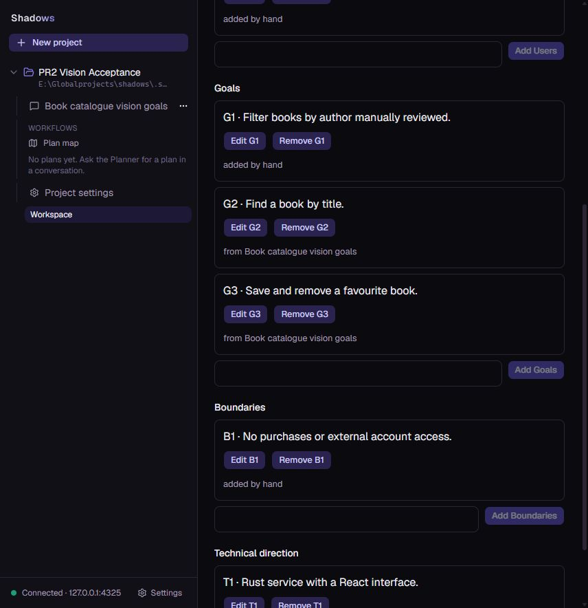

# §23 PR 2: vision proposals

Date: 2026-10-12, Asia/Aden. Local Windows implementation on
`next/guided-planning-pr2`, based on `c81a571`. No push, PR, merge or deployment.

## Delivered path

Vision items carry stable field-prefixed ids, text, last-edit conversation origin
and item revisions. Server-owned per-field counters prevent id reuse, including
an add followed by removal in one batch. Migration 0022 converts legacy text and
seeds counters/history; its empty-field classification covers Rust Unicode
whitespace. Each committed vision edit creates a version; no history UI ships.

The Planner's thread grant can propose one card per call in a running turn.
Approval is person HTTP only: replay first, live project, same-project proposal,
Pending state, exact item revision, then one atomic item change/version/event.
Adds remain independent of other edits. Pending edits/removals are superseded by
a newer proposal for that item; explicit `replaces` supersedes a pending proposal.
The original entry remains immutable; cards read their current status separately.

## Actual browser acceptance

Used the real local Claude Code ACP adapter and the in-app browser at
`http://127.0.0.1:5195`, against a separately built `pr2` daemon at port 4325.
The active original daemon was left alone. `.claude/launch.json` was not changed.
SQLite online backup copied the configured development DB into the ignored plan
workspace. That source was at migration 12 with no design workspace, so this is
an actual old-DB upgrade but not an existing-vision-row browser migration claim.
The populated legacy-vision fixture is covered by `plan_migration` instead.

Observed through actual UI actions:

- Real Planner emitted three pending goal cards without editing the vision.
- Approved the second then the first: ids were G1 and G2 in approval order.
- Requested replacement of the third; old card became Superseded without an
  approval button, and its replacement was approved as G3.
- Asked for an edit of G1 and another pending addition. The Planner initially
  supplied a field on the edit and received a typed refusal, then corrected it.
- Vision displayed G1–G3 with links to the originating conversation and counted
  two actionable pending cards.
- Hand-edited G1; the old edit card became Outdated with no Approve button.
  The pending count became one, excluding the outdated card.
- Added purpose, users, boundaries and technical direction by hand; conversation
  header moved to map with missing backend/database/api/frontend.
- Database inspection: migration 22, eight vision versions, three Approved,
  two Pending (one outdated), one Superseded proposal, zero foreign-key issues.

After the reviewer fix, the rebuilt daemon was restarted with inherited
RUST_LOG cleared. The browser restored all saved card states and stage. A fourth
real Planner turn successfully proposed a fresh G2 edit under the revalidated
running-turn path; it remains Pending. Debug log captured adapter startup,
HTTP 200 responses and the proposal tool path. No error-level lines occurred in
that restarted run at inspection.

Four real Planner turns were used; no MiniMax calls. Provider prose still
contained historical pending descriptions after earlier approvals; only the live
cards and owner state decide approval. No production or PR3+ acceptance claimed.

## Verification

Targeted RED/GREEN records live in the ignored plan ledger until final handoff.
Core item/standards suite passed 8 tests before proposals; proposal suite grew to
19 tests including the final review regression. Contracts, populated migration,
storage policy, HTTP routes and real MCP tests passed in their respective tasks.
Web: 243 tests across 47 files passed; TypeScript, oxlint and production build
passed. Vite reports existing large syntax-highlighting chunks.

The first full Rust gate failed `debug_log` because inherited `RUST_LOG`
suppressed its debug-level probe. Validation clears that inherited setting only
in its own command environment; no logging behavior was changed.

Final full Rust gate: cargo test --workspace exited 0: 462 passed, zero failed,
one explicitly ignored. cargo fmt --all --check, Clippy with all targets and
fake-acp/test-support, product-only Clippy, production feature tree (no test-support),
OpenAPI diff check and changed Rust line-width check passed. Six changed service
contracts parsed as YAML. Generated API files have no uncommitted changes.
Web gate passed on the completed UI; the later fix changed Rust only.

## Review and rulings

Mohammed requested the reviewer use the same model as the implementer; the
initial different-model review was interrupted and replaced. The completed
review found one P2 race: a captured running operation could finish before the
proposal write. Its regression failed before the fix. Turns now owns the exact
running-operation check inside Design's write transaction, after replay and
before supersession/card creation. No other blocking finding was reported.
The original full-gate run was repeated after that code correction.

Additional bounded choices: checked revision/counter arithmetic; Unicode legacy
whitespace; invocation-pinned standards provenance; distinct proposal recording,
reading and approval store files; actionable-only pending counts. The 412-line
proposal test module owns proposal lifecycle acceptance in the existing test
binary; the shared synthetic running-turn fixture keeps those assertions together.
The 373-line turn store continues to own turn recording and its transactional
preconditions; the added check is called by the first proposal writer that needs
to bind a card to an exact still-running operation.

## Remaining boundaries

§24 approval principal/agent enforcement, history UI, map/drift, structure and
later roadmap stages remain separate. This run does not establish Linux behavior,
remote CI or production deployment. The disposable acceptance DB and screenshots
are synthetic; they do not establish behavior on unavailable user data.

The acceptance process is left available for Mohammed to inspect; its synthetic
trial DB is retained in the ignored plan workspace. A disposable root Vite cache
was left untracked after automatic approval review rejected its cleanup command
without a detailed reason; it is not staged or part of the product.
