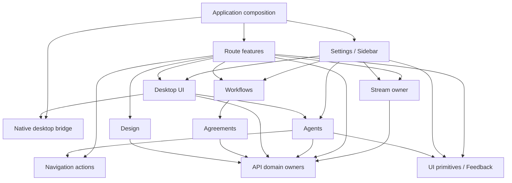

# Web architecture

Status: W-1 to W-10, W-12 and W-13 shipped (PR #43, PR #44). W-11 shipped in five packets
(F-45 to F-49 with B-14 to B-18, PR #47). Decisions below taken by Mohammed on 2026-10-25. The analysis that follows was written read-only by Codex from
`fix/flaky-tests` at `24a64289`.

## Decisions

1. **The module ownership graph is approved:** settings composes sections,
   `api/<domain>` owns query identities and cache writes, `stream/` owns event
   classification and refresh dispatch (section 6).
2. **Core supplies the facts the web copies today** (draft choices, validation
   limits, defaults, structure preview, turn facts). Each becomes a shared
   request; W-11 stays blocked per domain until the backend field exists.
3. **Person updates are partial:** each form sends only the fields it changed,
   and Core merges them, so a name save and a preferences save cannot
   overwrite each other. This needs a backend change (a partial person update)
   and a shared request.

Open: queued-message focus behaviour and cross-tab open-project sync
(section 8, items 4 and 5) are not decided.

---

The transport boundary largely holds today. The main architectural weakness is **ownership of cached state and event-driven refresh**, followed by unrestricted imports into feature internals. Establish those owners and an enforcing ratchet before moving many files.

This is a static, read-only report from `fix/flaky-tests`. No files were changed, no branch switch occurred, and no npm, Vitest, Cargo, or build commands ran. `web/` and `docs/frontend/` were clean before and after inspection. Concurrent `crates/` changes were excluded.

I used the installed TypeScript language-service library for source/import analysis, plus file reading. Backend comparisons below concern the requested architecture guidance and specifications, not verification of the concurrently changing backend implementation.

## 1. Inventory

Counts cover **all files under `web/src`**, including tests, contracts, generated declarations, CSS, and JSON. Lines are physical lines, including comments and blanks.

| Area under `web/src` | Job | Files | Lines | Contract | Code-map coverage |
|---|---|---:|---:|---|---|
| `api/` | Represent the daemon protocol | 18 | 10,005 | Yes | Complete |
| `stream/` | Consume resumable event streams | 11 | 2,300 | Yes | Complete |
| `desktop/` | Bridge the native runtime | 12 | 507 | **Present; invalid YAML** | Complete |
| `components/ui/` | Render domain-independent controls | 7 | 445 | None | Complete |
| `app/agents/` | Configure AYLUL providers and agents | 21 | 1,708 | Yes | Complete |
| `app/agreements/` | Edit versioned API agreements | 9 | 740 | Yes | Complete |
| `app/conversation/` | Present a conversation | 65 | 8,839 | Yes | Complete |
| `app/design/` | Edit project design | 22 | 2,148 | Yes | Complete |
| `app/desktop/` | Present native capabilities | 12 | 468 | Yes | Complete |
| `app/new-project/` | Create a project | 11 | 752 | Yes | Complete |
| `app/project-settings/` | Configure one project | 13 | 1,605 | Yes | Complete |
| `app/settings/` | Present application settings | 33 | 1,893 | Yes | Complete |
| `app/sidebar/` | Navigate workspaces | 13 | 1,307 | Yes | Complete |
| `app/workflows/` | Present workflow plans | 20 | 2,819 | Yes | Complete |
| Direct children of `app/` | **Mixed:** composition, feedback, policy, test support | 8 | 494 | None | Complete |
| `test/` | Supply integration-test fixtures | 4 | 626 | None | Complete for TypeScript |
| Direct children of `src/` | **Mixed:** startup, routing, styling, declarations, architecture test | 6 | 512 | No root contract | Complete for TypeScript |
| **Total** | | **285** | **37,168** | **13 contracts** | |

“Complete” means every non-test `.ts`/`.tsx` file has a row and every mapped path exists. It does **not** mean its stated job or dependency boundary is enforced.

The totals break down into:

| Category | Lines |
|---|---:|
| 190 implementation TypeScript files | 14,830 |
| 78 test files | 8,689 |
| Two declaration files | 7,897 |
| Contracts | 5,428 |
| CSS and JSON | 324 |

`api/schema.d.ts` alone contributes **7,893 lines**. It should not influence judgments about handwritten module size.

Important map discrepancies:

- The map says `main.tsx` owns the QueryClient. It actually lives in [app-root.tsx](../../../web/src/app-root.tsx).
- The map names `mode-policy.ts` as shared root code; its actual path is `app/mode-policy.ts`.
- References for uncontracted files often point sideways to another source file. That provides an example, not an ownership boundary.
- [desktop/contract.yaml:15](../../../web/src/desktop/contract.yaml:15) contains an unquoted scalar with `{ ok: true }`; standard YAML parsing rejects the embedded `: `.

There is no existing feature-entry convention such as `app/<feature>/index.ts`.

## 2. Dependency graph

The TypeScript scan resolved **921 local import/re-export/dynamic-import edges** across 270 TypeScript files. Of these, **678 originate in implementation files after excluding identified test-support modules**. These are source edges, not bundled-module counts.

### Area dependencies

Here, `app/root` means the eight direct children of `app/`; `src/root` means the startup/router files. Test support is excluded from this table.

| Area | Imports other areas |
|---|---|
| `api` | None within `src` |
| `components` | None outside its own area |
| `stream` | `api` |
| `desktop` | `api`, `app/desktop`, `src/root` |
| `app/agents` | `api`, `components`, `desktop`, `app/root`, `app/settings` |
| `app/agreements` | `api`, `components`, `app/root`, `app/design` |
| `app/conversation` | `api`, `components`, `desktop`, `stream`, `app/root`, `app/design`, `app/desktop`, `app/settings`, `app/workflows` |
| `app/design` | `api`, `components`, `app/root` |
| `app/desktop` | `api`, `desktop`, `app/agents` |
| `app/new-project` | `api`, `components`, `app/root` |
| `app/project-settings` | `api`, `components`, `app/root` |
| `app/settings` | `api`, `components`, `desktop`, `app/root`, `app/agents`, `app/desktop` |
| `app/sidebar` | `api`, `components`, `desktop`, `stream`, `app/root`, `app/agents`, `app/new-project`, `app/settings`, `app/workflows` |
| `app/workflows` | `api`, `components`, `stream`, `app/root`, `app/agreements` |
| `app/root` | `api`, `components`, `stream`, `app/new-project`, `app/settings`, `app/sidebar` |
| `src/root` | `desktop`, `app/root`, all ten feature areas |

### Every direct cross-feature import

Paths below are relative to `web/src/app/`. Each target is an implementation file rather than a declared public entry. There are **32 implementation edges plus two test edges**.

| Importer | Target |
|---|---|
| `agents/agent-extensions.tsx:7` | `settings/use-settings.ts` |
| `agents/agent-settings.tsx:21` | `settings/use-settings.ts` |
| `agents/home.tsx:9` | `settings/use-settings.ts` |
| `agreements/party-picker.tsx:5` | `design/use-part-pages.ts` |
| `conversation/composer.tsx:29` | `settings/use-settings.ts` |
| `conversation/conversation.tsx:11` | `desktop/companion-settings.tsx` |
| `conversation/conversation.tsx:13` | `workflows/plan-frames.ts` |
| `conversation/map-proposal-card.tsx:10` | `design/map-part-details.tsx` |
| `conversation/plan-card.tsx:9` | `workflows/plan-graph.tsx` |
| `conversation/plan-card.tsx:10` | `workflows/use-plan.ts` |
| `conversation/plan-side-panel.tsx:7` | `workflows/plan-graph.tsx` |
| `conversation/plan-side-panel.tsx:8` | `workflows/use-plan.ts` |
| `conversation/use-conversation.ts:10` | `workflows/plan-frames.ts` |
| `conversation/vision-proposal-card.tsx:10` | `design/vision-fields.ts` |
| `desktop/companion-settings.tsx:1` | `agents/provider-presets.ts` |
| `desktop/companion-settings.tsx:2` | `agents/character-colors.ts` |
| `desktop/companion-settings.tsx:3` | `agents/color-swatches.tsx` |
| `settings/sections/agents.tsx:5` | `agents/provider-presets.ts` |
| `settings/sections/agents.tsx:6` | `agents/color-swatches.tsx` |
| `settings/sections/agents.tsx:9` | `agents/agent-settings.tsx` |
| `settings/sections/character.tsx:1` | `desktop/companion-controls.tsx` |
| `settings/sections/character.tsx:2` | `desktop/companion-settings.tsx` |
| `settings/sections/core.tsx:1` | `desktop/connection-settings.tsx` |
| `settings/sections/providers.tsx:6` | `agents/provider-form.tsx` |
| `settings/sections/providers.tsx:7` | `agents/provider-picker.tsx` |
| `settings/sections/providers.tsx:8` | `agents/provider-presets.ts` |
| `sidebar/agent-list.tsx:12` | `agents/character-colors.ts` |
| `sidebar/agent-list.tsx:13` | `settings/use-settings.ts` |
| `sidebar/sidebar.tsx:11` | `new-project/open-new-project.ts` |
| `sidebar/sidebar.tsx:16` | `settings/use-settings.ts` |
| `sidebar/workflow-list.tsx:12` | `workflows/plan-state.ts` |
| `workflows/inspect-panel.tsx:9` | `agreements/binding-editor.tsx` |
| `desktop/companion-binding.test.tsx:7` | `settings/sections/character.tsx` |
| `desktop/companion-binding.test.tsx:8` | `agents/character-colors.ts` |

Some are sensible reusable capabilities: `PlanGraph`, `BindingEditor`, or `useOpenSettings`. The defect is that public capabilities are indistinguishable from private implementation.

Composition also reaches implementation files directly:

- `router.tsx` imports route components, `sidebar/workspace.ts`, and `settings/sections.ts`.
- `app/shell.tsx` imports the new-project provider, sidebar, settings dialog, and person-theme synchronization.
- `desktop/bootstrap.tsx` imports `app/desktop/connection-settings.tsx`.
- `desktop/navigation.ts` imports the application router.

The first two are legitimate composition responsibilities. The last two make the native infrastructure depend upward on application UI/composition.

### Cycles

**Runtime file cycles: none found.**

**File cycle including type imports: exactly one:**

```text
workflows/layout.ts
  ── value/type import ──► workflows/linked-layout.ts
  ◄──── type-only ────────
```

`linked-layout.ts:5` imports `PlanEdge` from `layout.ts`. This does not create a runtime initialization cycle. Moving graph types to an internal model file would remove the source cycle.

**Feature-only folder graph:** one cyclic component:

```text
agents → settings → desktop UI → agents
agents ← settings
```

**Full coarse folder graph:** one cyclic component containing `src/root`, `app/root`, all ten features, and native `desktop`. `api`, `stream`, and `components` are outside it. Grouping composition and reusable root files into folders enlarges this component; it must not be mistaken for a runtime file cycle.

### Server access outside `api`

No direct production `fetch`, generated-client construction, or generated-client HTTP call was found outside `api/`.

The deliberate streaming path is:

```text
api/client.ts: subscribeUrl / projectEventsUrl
    → stream/thread-stream.ts:121: new EventSource(url)
```

Additional observations:

- `workflows/plan-frames.ts:68` constructs `ThreadStream` outside `stream/`. It reuses the transport but owns another connection registry and refresh policy.
- Attachment elements use `attachmentUrl` from `api/client.ts`; they do not construct endpoint URLs themselves.
- `app/desktop/rule-preview.ts:13` calls an injected parameter named `fetch`. It is **not** a global network call.
- Native IPC is a separate boundary under `desktop/`, ultimately using `nativeCall`.
- Test support replaces global `fetch` and `EventSource`; these are fixtures.

## 3. State ownership

### Current owners

| State | Location | Assessment |
|---|---|---|
| Production QueryClient | `app-root.tsx` | One instance; good foundation |
| Most query identities | `api/queries.ts` | Centralized partially |
| Provider/agent identities | `api/aylul-profiles.ts` | Domain-local ownership |
| Person/extensions/usage identities | Their respective API files | Domain-local ownership |
| Agreement identities | Agreement components | Outside API owner |
| Session identity and cache replacement | `conversation/use-session.ts` | Server state owned by a feature |
| Slash-command identity and cache replacement | `conversation/use-commands.ts` | Server state owned by a feature |
| Stream cursor, reconnect budget, transient frames | `stream/thread-stream.ts` | Clear transport owner |
| Project connection registry | `stream/use-project-events.ts` | Shared per QueryClient/project |
| Plan writer-thread connection registry | `workflows/plan-frames.ts` | Separate registry outside stream owner |
| Turn projection | `conversation/turn-state.ts` | Local mirror of server lifecycle |
| Streamed/durable reply handoff | `conversation/reply.ts`, `messages.tsx` | Necessary presentation state |
| Form drafts | Feature components/hooks | Generally local |
| Workspace preference/history | `sidebar/workspace.ts` | Explicit browser-storage owner |
| Open projects | `sidebar/open-projects.ts` | Separate local-storage owner |
| Failed first-send handoff | `conversation/carried-send.ts` | Module-level map |
| Companion-send problem | `desktop/companion-send.ts` | Module-level external store |
| Native binding/connection snapshots | Native bridge hooks plus consuming components | Revision guards exist; subscriptions repeat |

### Highest-priority ownership problems

**1. Plan refresh has three owners.**

- [stream/use-project-events.ts](../../../web/src/stream/use-project-events.ts) handles project plan events.
- [workflows/plan-frames.ts](../../../web/src/app/workflows/plan-frames.ts) handles writer-thread plan events.
- [conversation/use-conversation.ts](../../../web/src/app/conversation/use-conversation.ts) interprets plan events and refreshes plans.

Their policies already differ:

- Project events include archive/unarchive; `PLAN_KINDS` in `plan-frames.ts` does not.
- Writer-thread handling invalidates the entire `workflows` prefix.
- Project handling performs more selective invalidation plus design/agreement refresh.

The registries also do not establish one globally shared connection per thread. `HeldThreadStream` avoids duplication through ancestry/context, rather than through one stream owner.

**2. Cache identities are a distributed protocol.**

Agreement components and stream code independently construct matching arrays. Other examples include design prefixes, extension prefixes, session keys, commands keys, native activity keys, and directory invalidations.

Changing a component’s key can silently disconnect its SSE refresh without breaking TypeScript.

**3. Mutation answers bypass the established race protection.**

Two verified examples:

- [agreements-page.tsx:63](../../../web/src/app/agreements/agreements-page.tsx:63)
- [agent-extensions.tsx:36](../../../web/src/app/agents/agent-extensions.tsx:36)

Both write mutation answers through `setQueryData` directly. `api/saved-answer.ts` already supplies `writeSaved`, which cancels the exact in-flight read first.

**4. A successful project-mode command remains reusable.**

`project-settings/project-modes.tsx` stores its pending attempt but never clears it on success. A later identical requested set can reuse a completed command identity. This is also explicitly recorded as a broken agreement in that module’s contract.

### Shared writes

Several screens legitimately affect the same server domain, but coordinate through cache implementation details:

| State | Writers/refresher paths |
|---|---|
| Projects list | Project creation, project-mode changes, project removal, project events |
| Workflow cache | Approval, archive, bindings, thread deletion, conversation events, project events, writer-thread events |
| Design cache | Editors, proposal approvals, structure creation, project events |
| Agreement cache | Agreement screen, binding editor, project events |
| Session cache | Opening query, options frames, composer mode/model/effort mutations |
| Person cache | Name form, preferences form |

For person state, both forms submit a whole record assembled from their observed snapshot. **Inference:** overlapping saves could overwrite an unrelated field with an older value. `writeSaved` protects cache ordering against reads; it does not merge concurrent server writes. Backend concurrency semantics were not verified.

### Duplicated decisions

| Decision | Copies or local reconstruction |
|---|---|
| Allowed/default modes | `app/mode-policy.ts`, draft session construction, project-mode editor |
| Model validation | `agents/model-picks.ts`, additional checks in `provider-models.tsx` |
| Context-window default | `provider-models.tsx` supplies `200000` |
| Provider/model limits | Model count, ID length, context bounds, label length in forms |
| Active-project bounds | `settings/active-projects.tsx` hardcodes `1..20` |
| Structure output count | `design/create-structure.tsx` walks the whole parts tree and predicts written files |
| Turn lifecycle | `conversation/turn-state.ts` defines statuses, terminal states, event mapping, transition rank |
| Proposal status/approval lifecycle | Vision, map, roadmap cards |
| Plan state wording | `workflows/plan-state.ts` displays `Approved`; `design/workspace-plans.tsx` displays raw `Frozen` |

The first group overlaps existing **F-18**. These are verified client-side rules; equality with today’s backend implementation is **not** asserted.

Not all local state is duplicated domain logic. Reply handoff, focus, dirty text, camera position, and upload previews are legitimate presentation concerns.

## 4. Mixed jobs, large files, misplaced tests

Size alone is not a reason to split. These files have identifiable responsibility boundaries:

| File | Lines | Separate jobs currently present |
|---|---:|---|
| `api/client.ts` | 578 | Construct transport; expose domain types; manage threads; manage sessions; manage projects; manage code index; manage workflows; manage agreements; browse filesystem |
| `stream/frames.ts` | 384 | Parse journal frames; parse session frames; parse usage frames; parse subagent frames; parse navigation notices |
| `conversation/composer.tsx` | 605 | Edit message; stage images; upload images; send turn; queue message; stop turn; switch session settings; operate slash menu; restore focus after settings |
| `conversation/draft.tsx` | 264 | Resolve draft route; fabricate pre-session choices; orchestrate first send; recover a partially completed first send |
| `conversation/carried-send.ts` | 69 | Store failed-send handoff; manage attachment-upload attempts |
| `conversation/messages.tsx` | 255 | Order transcript content; hand off streamed text; group tool activity; derive invocation notices |
| `agents/provider-form.tsx` | 178 | Edit provider; test connection; manage key; delete provider |
| `desktop/bootstrap.tsx` | 46 | Render startup UI; await readiness; watch configuration replacement; intercept external links |
| `app/test-app.tsx` | 184 | Mount integration app; fake transport; drive controls; poll assertions; manage global teardown |

`project-settings/code-index.tsx` is 224 lines, but its status/link controls remain within code-index configuration. `workflows/layout.ts` is 251 lines and largely earns its size through graph layout. Neither needs splitting merely to meet a line limit.

There are **no files named `utils` or `helpers`** under `web/src`.

Actual grab-bag pressure exists in:

- `api/client.ts`: unrelated protocol domains.
- `test/contract-fixtures.ts`: fixtures for many domains.
- `test/fake-daemon.ts`: one broad route table.
- Direct children of `app/`: product code mixed with policy and test infrastructure.

### Test placement

Most tests are colocated with their feature.

Specific exceptions or misleading ownership:

- `conversation/companion-send.test.tsx` primarily exercises `desktop/companion-send.ts`, while also covering first-send integration.
- `conversation/reply-text.test.tsx` exercises bidirectional rendering owned partly by `bidi.ts`.
- `conversation/reply.test.ts` includes `agentOrdinal` from `use-conversation.ts`.
- `app/desktop/companion-binding.test.tsx` tests a settings section across feature boundaries.
- `conversation/composer-bar.test.tsx` is **965 lines** and covers composer settings, attachments, queue behavior, and transcript images beyond the bar.
- `agents/aylul.test.tsx` is **459 lines**, spanning provider/agent journeys.
- `workflows/plan-page.test.tsx` is **406 lines**, including several plan behaviors.

Cross-feature journey tests are useful. Give them explicit integration ownership rather than disguising them as tests of one small component.

The test-support placement currently causes **no detected production reachability** from `main.tsx` to `app/test-app.tsx`, `test/`, or `stream/fake-event-source.ts`. The contract’s possible shipping concern can therefore be narrowed: the current issue is placement and missing enforcement, not a demonstrated bundle leak.

## 5. Existing enforcement and gaps

| Mechanism | What it holds | What it does not hold |
|---|---|---|
| `src/codemap.test.ts` | Non-test TS coverage; mapped-path existence; listed-contract existence; no “and” in job wording | Import boundaries; real responsibilities; YAML validity; contract contents; public exports; test ownership |
| Strict TypeScript | Type compatibility; unused symbols; switch fallthrough | Module privacy; ownership of query keys; allowed dependency directions |
| `@/*` alias | Consistent resolution | Any boundary; it exposes the whole source tree |
| `.oxlintrc.json` | Hook rules; component-export convention; normal lint defaults | Feature internals; forbidden upward dependencies; server access; cache ownership; cycles |
| Generated OpenAPI types | HTTP shape compatibility | Cache semantics; SSE invalidation completeness; native IPC completeness |
| CI schema regeneration | Generated source matches checked-in OpenAPI | A running daemon or browser journey |
| Feature tests | Many concrete interactions, retries, stale-answer cases | System-wide architectural invariants |
| Native fixtures/parity tests | Selected serialized native projections | All native wire types or real OS behavior |

The project uses **Oxlint, not ESLint**. Adding an ESLint boundary plugin would introduce another lint system. An extension using the existing TypeScript dependency is a smaller initial step.

The existing code-map test’s wording restriction is useful editorial pressure, but a sentence without “and” does not establish one responsibility.

The new Planner §13.16 is explicitly a **design decision with implementation still OPEN**. It should guide this plan; it is not evidence of an implemented architecture-approval gate.

## 6. Target structure

Keep the feature directories. Give each an explicit public surface, move server-state mechanics behind API owners, and make composition visible.

Do **not** copy Core’s runtime object model literally. React already has composition through components, providers, and hooks. A global service registry or client `AppCore` container is unnecessary here.

### Modules and entries

These are **proposed paths**, not existing files.

| Module | One job | Public entry / exposure |
|---|---|---|
| Application composition | Assemble the running client | `app-root.tsx`; `router.tsx`; startup composition |
| `app/navigation` | Navigate application destinations | `app/navigation/index.ts`: settings actions, workspace navigation |
| `app/feedback` | Present request/connection feedback | `app/feedback/index.ts`: `ErrorLine`, `DaemonStatus` |
| `components/ui` | Render generic controls | Individual public component files |
| `api/<domain>` | Own one domain’s server-state access | Domain `index.ts`: operations, query options, keys, cache-update methods, generated type aliases |
| `stream` | Own event delivery and refresh dispatch | `stream/index.ts`: lifecycle hooks, notices, event types |
| Native `desktop` | Translate native IPC | `desktop/index.ts`: typed calls, subscriptions, readiness facts |
| `app/agents` | Configure AYLUL identities | `index.ts`: forms, provider presentation, character controls |
| `app/agreements` | Edit versioned agreements | `index.ts`: page, `BindingEditor` |
| `app/conversation` | Present conversation interaction | `index.ts`: route components |
| `app/design` | Edit project design | `index.ts`: workspace page, proposal-content views |
| `app/desktop` | Present native capabilities | `index.ts`: activity, connection controls, companion controls |
| `app/new-project` | Create projects | `index.ts`: provider, open action |
| `app/project-settings` | Configure one project | `index.ts`: route component |
| `app/settings` | Compose settings sections | `index.ts`: dialog, theme application |
| `app/sidebar` | Navigate workspaces | `index.ts`: sidebar |
| `test` | Supply test infrastructure | Explicit test-support entries; unreachable from production |

API domains can be established from current users: projects, threads/turns, sessions, workflows, design, agreements, code, grants, filesystem, AYLUL profiles, person, extensions, usage. These are internal modules within `api/`, not packages or additional application layers.

### Allowed directions



This diagram groups some repeated downward edges for readability. The code-map module table should enumerate the exact allowed edges.

Necessary changes to make that graph hold:

- Extract settings navigation from `settings/` so agents no longer depend on settings composition.
- Move shared part-query pagination out of design UI ownership into the API design owner; agreements should not import a design editor hook.
- Move native startup rendering and router integration into application composition. Native infrastructure supplies facts and callbacks.
- Move `noteCompanionSend` orchestration out of the low-level native bridge into desktop UI/application behavior.
- Let design’s plan list use a public workflow presentation capability if needed; avoid copying workflow labels.
- Export only capabilities with current external callers. Do not expose every internal component.

Preserve lazy loading: public entries must use explicit exports. Keep route entries separate where importing a broad barrel would pull unrelated screens or initialization into the same dependency path.

### Enforcing check

Add `web/src/architecture.test.ts`, using the installed TypeScript parser/resolver. Extend the code map with a canonical module table: owner, entry, contract, allowed dependencies.

The check should reject:

1. Cross-module imports except declared public entries.
2. Dependencies outside the allowed graph, including type-only dependencies.
3. New runtime file cycles.
4. `fetch`, `EventSource`, or generated-client access outside their owners.
5. Query-key construction or cache writes outside approved server-state owners.
6. Production reachability to test infrastructure.
7. Invalid/missing contracts or entries inconsistent with the map.

Important implementation details:

- Resolve aliases, relative paths, re-exports, and literal dynamic imports.
- Resolve called identifiers: do not flag the injected `fetch` callback in `RulePreviewGuard`.
- Keep test exceptions explicit; do not exempt every `*.test.*` from all architecture rules.
- Seed existing violations with precise identities such as `importer :: target :: rule`.
- Reject stale allowlist entries and new violations. A one-to-one path rename may preserve an existing exception; it must not count as a fix.
- Prove rejection through **in-memory fixture sources**, including alias bypasses, type imports, dynamic imports, and test-support reachability.

Static architecture checks cannot establish that two implementations encode the same business decision. Contracts, agreement tests, and review still hold that part.

## 7. Ordered tasks

These are proposed task packets, not changes to `stages.md`. Before dispatch, the controller should enumerate migration caller files from the import inventory. Every affected contract and code-map row belongs in the same task’s `Touch`.

### W-1 · Establish the frontend architecture ratchet

- **Touch:** `web/src/architecture.test.ts` and its fixture/baseline files; `web/src/codemap.test.ts`; `docs/frontend/codebase/README.md`; `docs/frontend/stages.md`; `web/package.json` and lockfile only if a direct YAML-parser development dependency is needed.
- **Needs:** Agreement on the module table and allowed directions in section 6.
- **Done-when:** Current violations are explicitly baselined; new/stale violations fail; fixture cases prove import resolution, boundary checks, network-owner detection, and production/test separation. Existing behavior is unchanged.

This comes first. The invalid desktop contract is an explicit temporary baseline item, not silently skipped.

### W-2 · Make contracts parseable and map startup ownership truthfully

- **Touch:** `web/src/desktop/contract.yaml`; `docs/frontend/codebase/README.md`; architecture baseline.
- **Needs:** W-1.
- **Done-when:** All 13 contracts parse; the desktop syntax exception disappears; map rows correctly identify QueryClient ownership and the policy path.

### W-3 · Fix the provider Enter behavior

- **Touch:** `app/agents/provider-form.tsx`, `provider-models.tsx`, `provider-setup.test.tsx`, `agents/contract.yaml`.
- **Needs:** W-1; absorbs existing F-16.
- **Done-when:** Enter in the manual-model field adds the model without submitting the provider; saving with unadded input produces an explicit result; relevant tests, typecheck, lint pass.

### W-4 · Establish API-owned query identities and safe cache writes

- **Touch:** API key/update modules; `agreements-page.tsx`, `binding-editor.tsx`; `agent-extensions.tsx`; `conversation/use-session.ts`, `use-commands.ts`, composer callers; literal-key callers identified in section 3; corresponding contracts/tests/map/baseline.
- **Needs:** W-1; absorbs F-17.
- **Done-when:** Features contain no server-query identity literals; mutation answers use owner methods backed by `writeSaved`; session/command frames update through their owner; stale-read regression cases pass.

Split this into per-domain commits. Preserve key values initially.

### W-5 · Remove the navigation and native upward dependencies

- **Touch:** New `app/navigation/` entry/contract; `settings/use-settings.ts` and callers; `desktop/bootstrap.tsx`, `navigation.ts`, `companion-send.ts`; startup composition; `app/desktop/` orchestration; affected contracts/tests/map/baseline.
- **Needs:** W-1; W-4 for moved cache access.
- **Done-when:** Agents no longer import settings composition; native infrastructure imports neither application UI nor the router; readiness ordering and applied-navigation acknowledgement tests remain intact.

Treat navigation extraction and native composition changes as separate commits.

### W-6 · Declare feature entries and close private imports

- **Touch:** The ten feature entries/contracts; the 34 cross-feature edges listed in section 2; router/shell consumers; API design pagination owner; map/baseline.
- **Needs:** W-5.
- **Done-when:** Every remaining cross-feature import names a declared public entry; unused internal exports remain private by convention/check; feature dependency graph is acyclic; route lazy-loading behavior is preserved.

Use one importing area per commit.

### W-7 · Give stream refresh one owner

- **Touch:** `stream/`; `workflows/plan-frames.ts`, `use-plan.ts`; `conversation/use-conversation.ts`, `conversation.tsx`; affected workflow/conversation/stream tests/contracts; API invalidation methods; map/baseline.
- **Needs:** W-4 and W-6; absorbs the independent refresh portion of F-19.
- **Done-when:** Event classification and refresh dispatch live under `stream/`; features hold no connection registries; project/thread overlap, replay, archive/unarchive, shared watchers, and last-subscriber cleanup have focused coverage.

Preserve both project-stream and writer-thread functionality until their consumers prove replacement.

### W-8 · Split the API transport from domain operations

- **Touch:** `api/client.ts`, `queries.ts`, existing API domain files, new domain entries; their import callers; API contract; map/baseline.
- **Needs:** W-4.
- **Done-when:** Exactly one low-level generated client remains; domain operations/query identities have explicit owners; features cannot import the low-level client; generated schema remains untouched unless an accepted backend change requires regeneration.

Migrate one domain per commit. This absorbs the API portion of F-20.

### W-9 · Split conversation behavior by job

- **Touch:** `conversation/composer.tsx`, `draft.tsx`, `carried-send.ts`, their extracted private files, focused tests, conversation contract/map/baseline.
- **Needs:** W-4 and W-7.
- **Done-when:** Send/queue orchestration, session-setting changes, attachment lifecycle, and message editing have separate owners; failed first-send handoff, upload identity, retries, text retention, focus restoration, and Stop behavior remain covered.

Do not combine this move with changing Core-owned mode defaults.

### W-10 · Consolidate repeated presentation behavior

- **Touch:** Three proposal-card files/tests; `agents/delete-zone.tsx`, `sidebar/delete-thread-dialog.tsx`, `project-settings/remove-project.tsx`, `settings/extension-list.tsx`; a narrowly scoped confirmation component; `design/workspace-plans.tsx`; public workflow labels; contracts/map/baseline.
- **Needs:** W-6; proposal lifecycle follows W-4.
- **Done-when:** One proposal approval/status lifecycle is reused; content rendering stays domain-specific; confirmation rendering is shared without sharing mutation state; frozen plans use consistent wording.

This absorbs the presentation portion of F-19. Separate proposal, confirmation, and label commits.

**Desktop capabilities (its own commit in W-10).** Today seven files outside `desktop/` and
`app/desktop/` each ask `isDesktop()` and decide for themselves what to show:
`app/settings/sections.ts`, `settings/sections/{general,account,agents}.tsx`,
`sidebar/sidebar.tsx`, `agents/agent-settings.tsx` and `router.tsx`.

- **Touch:** `web/src/desktop/` (a capabilities object, created once at start-up, with one field
  per native feature: local Core, companion, tray navigation, account login item; the browser
  build gets all `false`); the seven files above; `web/src/app/desktop/` where its sections and
  sidebar entries register; `web/src/architecture.test.ts` (a rule with a failing fixture that
  refuses `isDesktop()` outside `desktop/`), its baseline, contracts and the code map.
- **Done-when:** screens ask for a capability (`capabilities.companion`), never for the platform.
  Desktop-only sections and sidebar entries are registered from `app/desktop/` in one place.
  `isDesktop()` is read only inside `desktop/`. Browser and desktop show exactly what they show
  today (the existing settings and sidebar tests stay green unchanged).
- **Why:** a new native feature (an in-app browser or terminal later) is one new capability:
  its bridge in `desktop/` and its screen in `app/desktop/`, with no edit to unrelated screens.
  The same capabilities later tell Core which desktop-only MCP tools to offer an agent
  (`docs/aylul/future.md`, "AYLUL's own MCP tools"); that part is not in this task.

### W-11 · Remove copied Core decisions after API support exists

- **Touch:** `agents/model-picks.ts`, `provider-models.tsx`, provider/agent forms; `app/mode-policy.ts`; draft choices; project-mode editor; `settings/active-projects.tsx`; `design/create-structure.tsx`; `conversation/turn-state.ts`; affected contracts/tests; generated schema through tooling only.
- **Needs:** Accepted shared request(s), implemented backend fields, regenerated OpenAPI; absorbs F-18 and the blocked status portion of F-19.
- **Done-when:** Core supplies validation/default/capability facts needed by these consumers; client shows those facts; copied policies disappear; stale-event reconciliation remains correct.

Keep this blocked by domain rather than blocking all frontend architecture work.

**Packets (controller, 2026-10-29).** Each packet is one shared request, one Core
task and one web task, delivered on the same branch so CI's OpenAPI types check
stays green. Packets are independent; they run in this order:

| Packet | Copied rule in the web | Core owner today | Request | Core task | Web task |
|---|---|---|---|---|---|
| 1 `model-picks` | `agents/model-picks.ts`: 1 to 20 models, ids up to 128 printable characters, `default` reserved, context window 1000 to 10000000; `provider-form.tsx`: label up to 64; `provider-models.tsx`: window default 200000 | `core-providers/src/validation.rs` | [provider-refusals](../../shared/requests/2026-10-29-provider-refusals.md) | B-14 | F-45 |
| 2 `active-limit` | `settings/active-projects.tsx`: `MIN = 1`, `MAX = 20` | `core-code` (`code_setting.active_limit`) | [active-limit-bounds](../../shared/requests/2026-10-29-active-limit-bounds.md) | B-15 | F-46 |
| 3 `mode-policy` | `mode-policy.ts`: allowed modes, labels, descriptions, initial and unattended mode per harness | `shadows-agent/src/policy.rs`, listed by `Harness::list` | [harness-mode-policy](../../shared/requests/2026-10-29-harness-mode-policy.md) | B-16 | F-47 |
| 4 `structure-count` | `design/create-structure.tsx::fileCount`: walks every part to count the files a structure writes | `core-design` (`create_structure`) | [structure-file-count](../../shared/requests/2026-10-29-structure-file-count.md) | B-17 | F-48 |
| 5 `turn-state` | `conversation/turn-state.ts`: orders snapshot and stream statuses so a stale one cannot move a turn back | `core-operations` | [turn-status-order](../../shared/requests/2026-10-30-turn-status-order.md) | B-18 | F-49 |

Each web task deletes the copy, shows Core's answer, and keeps its form's current
behaviour (instant save, retained errors, one command id per attempt).

**Packet 5 ruling (Mohammed, 2026-10-30).** The status rank and the event-kind table
are Core's lifecycle copied, not presentation. Core gives each operation row its
latest journal `seq` and each operation event the status it leaves; the client keeps
the source with the higher `seq` per turn. `stopRequested`, `endedAt` and which turn
is running stay client presentation.

### W-12 · Put test infrastructure under its owner

- **Touch:** `app/test-app.tsx` → `test/`; `stream/fake-event-source.ts` → `test/`; `test/fake-daemon.ts`, fixture modules; importing tests; oversized composer test file; relevant contracts/map/baseline.
- **Needs:** W-1; coordinate with W-9.
- **Done-when:** Product directories contain no test harness/double; production-reachability check stays clean; component tests and cross-feature journeys are named/placed by what they verify.

Move first; split shared fixtures only where existing callers justify it.

### W-13 · Close the branch with architecture and interaction evidence

- **Touch:** Frontend stages and code map; affected contracts; dated evidence if required by the delivery process.
- **Needs:** Completed unblocked tasks.
- **Done-when:** Architecture/codemap checks, typecheck, lint, relevant tests, then the agreed full web gate pass; browser journeys cover send/queue/Stop, settings, proposals, replay, conflict recovery; desktop acceptance separately covers readiness and navigation.

These are **future validation requirements**, not checks performed for this report.

**Parallel work:**

- After W-1: W-2, W-3, and W-12’s relocation preparation can proceed independently.
- W-4 can split by server domain, with exclusive API-file ownership.
- After ownership settles: W-8’s API domain moves and W-9’s conversation split can proceed in parallel only for API domains whose callers exclude W-9’s files (`composer.tsx`, `draft.tsx`, `carried-send.ts` and their callers); the session, turn and upload domains move in series with W-9.
- W-10’s proposal and confirmation work can be separate lanes.
- W-7 and W-9 should not edit conversation orchestration simultaneously.
- Contracts, the code map, stages, and baseline files require serialized integration.
- F-21 comment cleanup should accompany touched files or a later isolated task, avoiding a branch-wide conflicting edit.
- F-22 remains governed by its existing accepted-request/evidence requirements.

## 8. Risks and decisions for Mohammed

### Decisions requiring Mohammed

Items 1 to 3 are decided; see "Decisions" at the top. Partial person updates are asked in
[`docs/shared/requests/2026-10-26-partial-person-update.md`](../../shared/requests/2026-10-26-partial-person-update.md)
and built by F-28; F-17's cache-write work does not complete that decision.
4. **Resolve queued-message focus behavior.** Sending clears the focus chip; queue success currently does not. The intended user behavior remains unclear.
5. **Choose cross-tab navigation synchronization.** Open-project state currently persists per-tab snapshots without merging changes from other tabs. Change only if synchronized behavior is wanted.

### Migration risks

- A broad barrel can change lazy-loading boundaries or eagerly evaluate `api/client.ts` before desktop readiness freezes the origin.
- Removing one refresh path prematurely can lose updates for plans written by another thread or external writer.
- Removing the turn reducer without an adequate authoritative replacement can reintroduce stale-snapshot regressions.
- Moving uploads or draft handoff can lose replay identities, retained images, or the distinction between a created thread and an accepted turn.
- Feature-boundary checks can be technically green while a public entry exports the entire feature. Public surfaces need deliberate review.
- Shared confirmation UI must not centralize unrelated command identities or pending state.
- Static analysis establishes import and ownership structure. It does not establish browser, native, provider, or production acceptance.

The smallest useful first delivery is **W-1 through W-4**: establish the ratchet, repair contract validity, fix the known form behavior, and stop cache identities/writes from spreading further.

